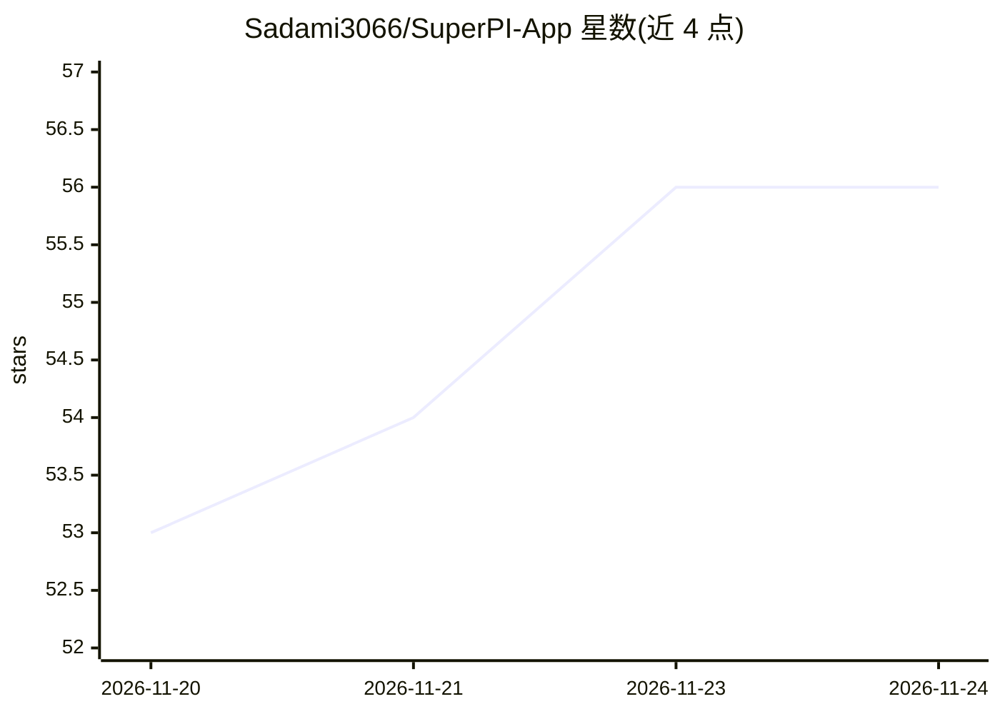

# Sadami3066/SuperPI-App

⭐ 56 · Kotlin · Apache-2.0 · 推送 2026-11-22 · [GitHub](https://github.com/Sadami3066/SuperPI-App) · 个人维护 · 中文 README

**Android 本机运行的插件化个人 AI 智能体**

运行在 Android 手机上的个人智能体：长按电源键唤醒，通过语音或文字下达任务，在本机完成文件读写、其他应用操作、Linux 命令执行与外部服务连接。包含工具、技能、长期记忆、MCP 连接器与签名 .ddp 插件系统，内置 Alpine/proot Linux 用户空间。无自建后端与账号系统，模型请求仅发送给用户配置的服务商。系统要求 Android 10+，APK 经 GitHub Releases 分发，未上架应用商店；Root 档直接使用系统 root 环境。

## 筛选速览

| 维度 | 判定 | 备注 |
|---|---|---|
| AI 角色 | `ai-native` | 本体是模型或模型工具 |
| 许可风险 | `permissive` | Apache-2.0 |
| 部署形态 | `None` |  |
| 模型依赖 | — | README 未给出锁定关系 |
| 硬件要求 | — | 无带数字的原话,不猜 |
| 安装摩擦 | `medium` | 含编译或系统依赖之一 |
| 成熟度 | — | 结构信号不足 |

## 能力要点

- 完整 Agent Harness：工具、技能、长期记忆、MCP 连接器与插件系统
- 内置 Alpine/proot 用户空间，可运行 shell、Node、Python 与编译工具链
- 支持多家模型服务商，API Key 或 OAuth 登录
- 签名 .ddp 插件生态，市场提供插件、技能与远程 MCP

## 适用场景

- 在手机上让 Agent 读写文件、运行 Linux 命令完成办公与代码任务
- 通过屏幕工具操作其他 App，后台自动执行定时任务
- 用插件接入飞书、邮箱、地图、火车票等外部服务

## 场景标签

`AI 助手` `Agent 记忆` · 领域:Agent 开发

## 证据(README 行号)

> L23: Super PI Agent 是跑在 Android 手机上的个人智能体。长按电源键唤醒，用语音或文字说出需求，它会在本机把事情做完：读写文件、操作其他应用、运行 Linux 命令、连接外部服务。
> L27: Super PI Agent 包含一套完整的 Agent Harness：工具、技能、长期记忆、MCP 连接器与插件系统；内置轻量 Linux 环境，覆盖大部分桌面办公与代码任务；通过插件可以接入飞书、企业微信、中山大学校园服务、
> L41: - **模型自由**：支持多家模型服务商，API Key 或 OAuth 登录；模型与思考档按会话选择。

## 星数曲线

2026-11-20 53 → 2026-11-24 56（+3）

---
*卡片 v1 · prompt 1.4 · 生成 2026-11-20 · 置信度 high · 依据 README sha `60a263cf4dbb` · [字段定义](../../DATASET.md)*
