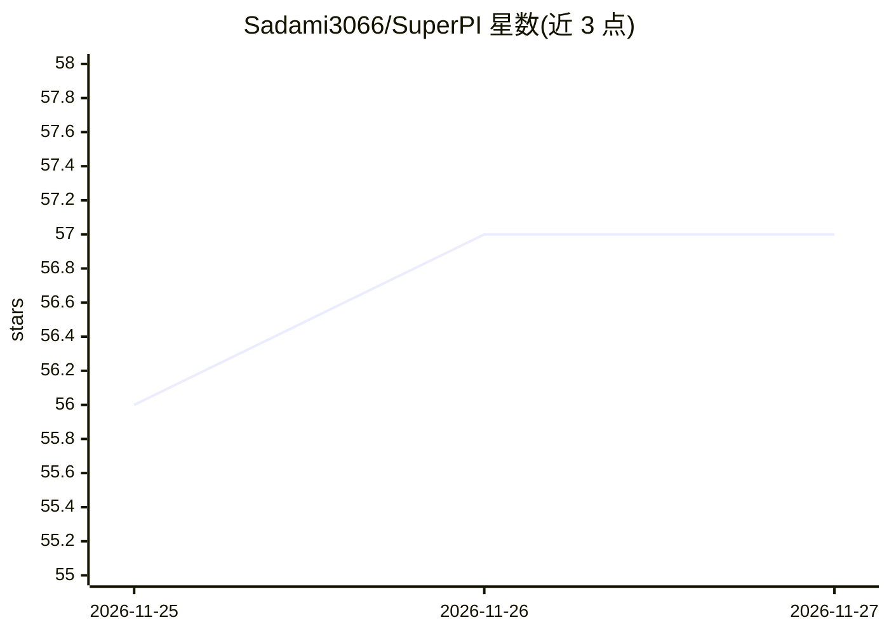

# Sadami3066/SuperPI

⭐ 57 · Kotlin · Apache-2.0 · 推送 2026-11-25 · [GitHub](https://github.com/Sadami3066/SuperPI) · 个人维护 · 中文 README

**本地优先的个人 AI Agent 生态：手机/桌面/自托管中继/插件平台**

由四个部分组成的 monorepo：Jetpack Compose 构建的 Android 端本地个人 Agent（长按电源键语音或输入、内置 Alpine/proot 运行 Linux 命令、无线 ADB 屏幕自动化、加载签名 .ddp 插件）；Electron + React 桌面壳通过 JSONL RPC 驱动官方 pi agent；可选的自托管 Node.js 24 中继服务负责跨设备 bot 路由、加密配对与 Memory v2 同步；以及 10 个官方插件与第三方插件模板。默认所有对话、API key 与会话保留在设备上。提供 Android APK 下载、Docker 部署中继、pnpm 构建桌面端。

## 筛选速览

| 维度 | 判定 | 备注 |
|---|---|---|
| AI 角色 | `ai-native` | 本体是模型或模型工具 |
| 许可风险 | `permissive` | Apache-2.0 |
| 部署形态 | `self-host` | docker 或自建部署 |
| 模型依赖 | — | README 未给出锁定关系 |
| 硬件要求 | — | 无带数字的原话,不猜 |
| 安装摩擦 | `low` | 无编译、无系统依赖或容器化 |
| 成熟度 | — | 结构信号不足 |

## 能力要点

- Android 端内置 Alpine/proot 环境可运行 Linux 命令
- 42 个内置模型 provider 或自定义端点接入
- 自托管 Relay 支持加密配对、文件传输与 Memory v2 同步
- 10 个官方 .ddp 插件与第三方插件开发模板

## 适用场景

- 在手机上通过语音/文字驱动本地 Agent 执行命令与自动化
- 自托管中继在多设备间同步记忆与路由 bot
- 开发签名 .ddp 插件扩展 Agent 能力

## 场景标签

`AI 助手` `GUI 自动化` · 领域:效率与自动化

## 证据(README 行号)

> L5: **Personal AI Agent Ecosystem — Android · Desktop · Self-Hosted Relay · Plugin Platform**
> L25: **SuperPI** is a local-first personal AI agent ecosystem:
> L27: - **Android (`apps/android`)**: On-device personal agent built with Jetpack Compose. Long-press the power button to

## 星数曲线

2026-11-25 56 → 2026-11-27 57（+1）

---
*卡片 v1 · prompt 1.4 · 生成 2026-11-24 · 置信度 mid · 依据 README sha `7944902de912` · [字段定义](../../DATASET.md)*
