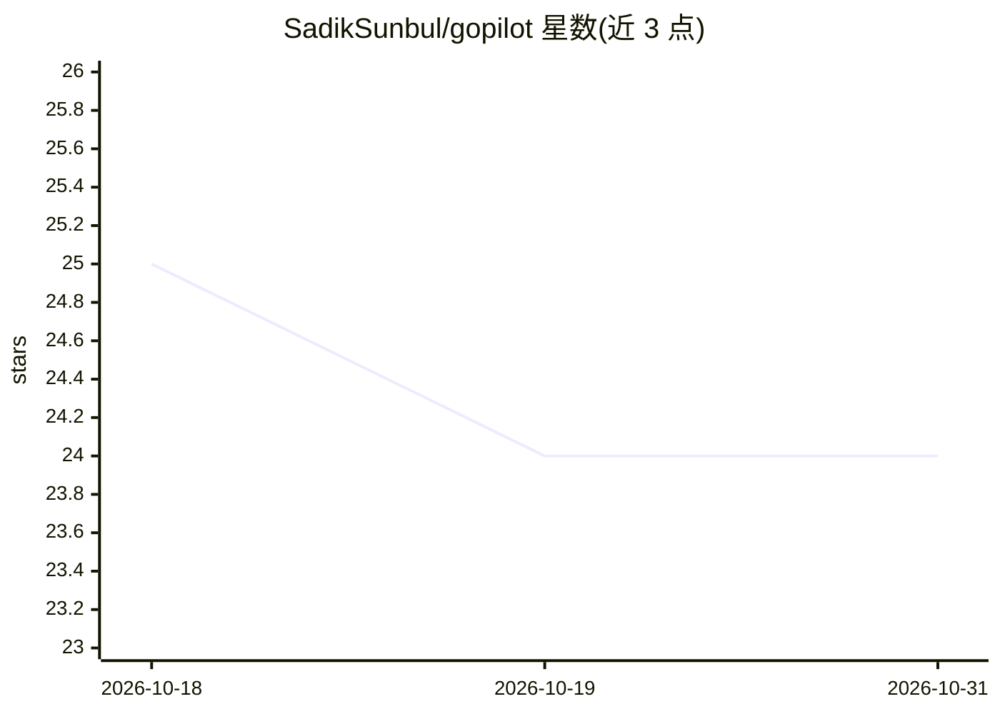

# SadikSunbul/gopilot

⭐ 24 · Go · MIT · 推送 2026-01-28 · [GitHub](https://github.com/SadikSunbul/gopilot) · [官网](https://go-pilot.vercel.app/) · 个人维护

**Go 函数的自然语言路由库：用 LLM 把用户话语映射到函数调用**

面向 Go 开发者的自动化库：开发者注册带结构体标签描述的函数，库读取用户自然语言输入，通过 LLM 将查询路由到合适的函数，并把动态输入转换为强类型参数、校验必填项后执行，返回灵活格式的响应。支持嵌套复杂参数类型与交互式 CLI 用法。当前处于活跃开发阶段，仅支持 Gemini 一种 LLM 后端。以 go get 方式安装，MIT 许可。

## 筛选速览

| 维度 | 判定 | 备注 |
|---|---|---|
| AI 角色 | `ai-ecosystem` | LLM/agent 周边工具 |
| 许可风险 | `permissive` | MIT |
| 部署形态 | `None` |  |
| 模型依赖 | — | README 未给出锁定关系 |
| 硬件要求 | — | 无带数字的原话,不猜 |
| 安装摩擦 | `low` | 无编译、无系统依赖或容器化 |
| 成熟度 | `idea` | |

## 能力要点

- 自然语言查询自动路由到已注册函数
- 动态输入到强类型参数的类型安全映射
- 基于 struct 标签的必填参数自动校验
- 支持嵌套复杂参数类型与交互式 CLI

## 适用场景

- 为 CLI 工具添加自然语言操作入口
- 让用户用一句话触发对应的 Go 业务函数
- 构建基于函数注册的轻量 agent 应用

## 场景标签

`Agent 框架` · 领域:Agent 开发

## 证据(README 行号)

> L14: GoPilot is an intelligent automation library that enables natural language interaction with your Go functions. It a
> L19: - 🎯 **Automatic Function Routing**: Map queries to the most appropriate function

## 星数曲线

2026-10-18 25 → 2026-10-31 24（-1）

---
*卡片 v1 · prompt 1.4 · 生成 2026-10-27 · 置信度 high · 依据 README sha `58d689ea022e` · [字段定义](../../DATASET.md)*
