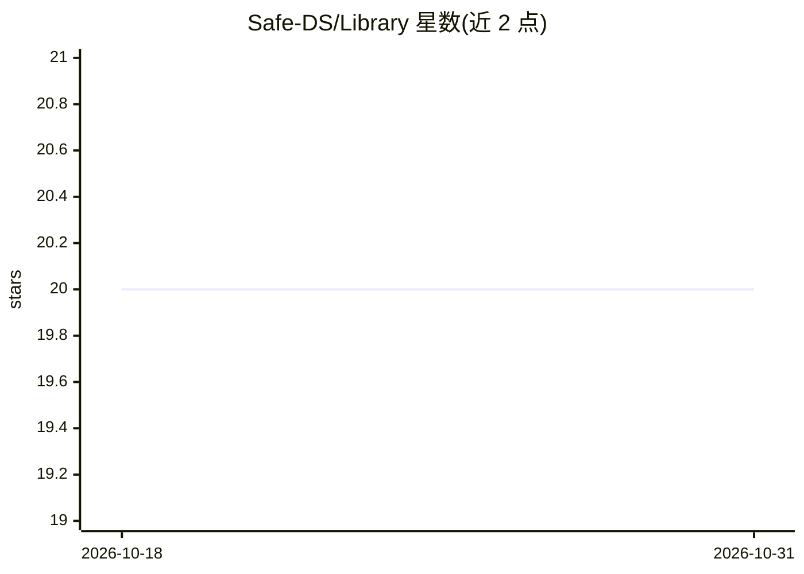

# Safe-DS/Library

⭐ 20 · Python · MIT · 推送 2026-07-26 · [GitHub](https://github.com/Safe-DS/Library) · [官网](https://library.safeds.com) · 组织维护

**面向初学者的易用 Python 数据科学库**

Safe-DS Python 库的目标是通过简单、直观、一致的 API 让数据科学更易被大众使用，主要面向 DS 初学者，处理小型到中等规模数据集上的常见任务。它不从头实现 DS 方法，而是在底层使用 polars（表格数据）、scikit-learn（经典机器学习）、torch（深度学习）与 matplotlib（可视化）等既有库；专业化任务建议直接使用其他 DS 库。以 pip 包形式从 PyPI 安装，可选安装 CUDA 版 torch/torchvision；仍处于 0.y.z 开发阶段，可能有不带主版本号变更的破坏性改动，尚未面向生产环境。

## 筛选速览

| 维度 | 判定 | 备注 |
|---|---|---|
| AI 角色 | `ai-native` | 本体是模型或模型工具 |
| 许可风险 | `permissive` | MIT |
| 部署形态 | `library` | 以包/库形式分发 |
| 模型依赖 | — | README 未给出锁定关系 |
| 硬件要求 | — | 无带数字的原话,不猜 |
| 安装摩擦 | `medium` | 含编译或系统依赖之一 |
| 成熟度 | `idea` | |

## 能力要点

- 为 DS 初学者提供简单一致的 API
- 底层复用 polars、scikit-learn、torch、matplotlib
- 支持小型到中等规模数据集的常见任务

## 适用场景

- 初学者学习数据科学常见任务
- 用统一 API 完成表格处理、机器学习、可视化

## 场景标签

 · 领域:数据科学/机器学习库

## 证据(README 行号)

> L10: Our goal is to make DS more accessible to a wider audience by providing a simple, intuitive, and consistent API to 
> L13: Instead of implementing DS methods from scratch, we use established DS libraries under the hood such as:

## 星数曲线

2026-10-18 20 → 2026-10-31 20（+0）

---
*卡片 v1 · prompt 1.4 · 生成 2026-10-28 · 置信度 high · 依据 README sha `a522970a2078` · [字段定义](../../DATASET.md)*
