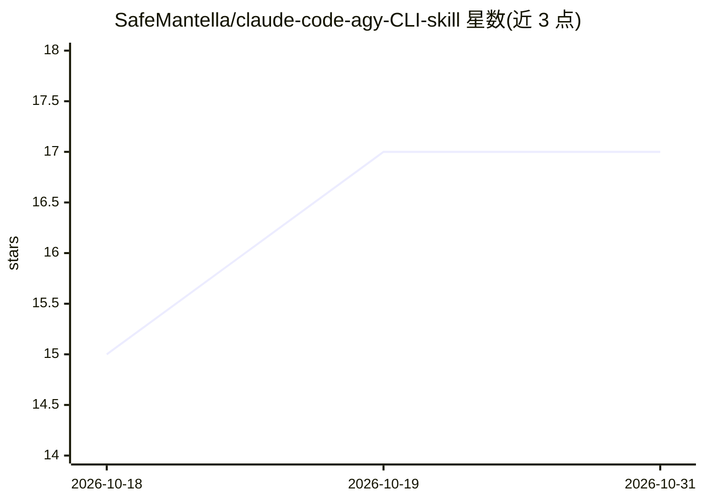

# SafeMantella/claude-code-agy-CLI-skill

⭐ 17 · MIT · 推送 2026-05-20 · [GitHub](https://github.com/SafeMantella/claude-code-agy-CLI-skill) · 个人维护

**让 Claude Code 把重任务委派给 Antigravity CLI 的多 agent 技能**

面向 Claude Code 用户的 SKILL.md 格式技能：通过 YAML frontmatter 描述触发条件，使 Claude 在需要 Google 搜索接地、图像生成、代码库整体分析、Chrome DevTools 调试或 40+ 科学数据库（gnomAD、UniProt、PubMed、AlphaFold 等）查询时，自动调用 agy 二进制（agy -p "..."）执行并只处理最终输出，以减少自身 token 消耗。内置委派启发式（按预计工具调用次数与是否为 agy 独占能力决定）、12 个提示模板、8 个编排模式。安装方式为 git clone 到 ~/.claude/skills/ 目录并手动修改 SKILL.md 中的二进制路径；要求 Claude Code 2.1+ 与 Antigravity CLI 0.2.x+，在 macOS 测试、Linux 应可用。

## 筛选速览

| 维度 | 判定 | 备注 |
|---|---|---|
| AI 角色 | `ai-ecosystem` | LLM/agent 周边工具 |
| 许可风险 | `permissive` | MIT |
| 部署形态 | `self-host` | docker 或自建部署 |
| 模型依赖 | locked-api |  |
| 硬件要求 | — | 无带数字的原话,不猜 |
| 安装摩擦 | `low` | 无编译、无系统依赖或容器化 |
| 成熟度 | — | 结构信号不足 |

## 能力要点

- Claude Code 按启发式规则自动委派任务给 agy CLI（独占能力一律委派）
- 覆盖 Google 搜索接地、图像生成、代码库分析、Chrome DevTools 与 40+ 科学数据库
- 含 12 个提示模板与 8 个编排模式（并行委派、多轮对话、研究-决策-执行）

## 适用场景

- 编码时让 Claude 借助 Google 搜索获取实时信息（CVE、新版本变更）
- 将大规模重构或多文件任务委派给 agy 以保留 Claude 上下文窗口
- 查询 gnomAD、AlphaFold、UniProt 等科学数据库

## 场景标签

`多智能体` `编码 Agent` · 领域:Agent 开发

## 证据(README 行号)

> L3: > **Multi-agent skill for Claude Code** that delegates heavy tasks to Google's Antigravity CLI agents — saving token
> L13: Claude Code is great at interactive coding. Antigravity CLI (`agy`) has exclusive tools Claude doesn't — **Google S
> L18: You ──► Claude Code ──► "this needs web search" ──► agy -p "..." ──► result ──► Claude Code ──► You

## 星数曲线

2026-10-18 15 → 2026-10-31 17（+2）

---
*卡片 v1 · prompt 1.4 · 生成 2026-10-29 · 置信度 mid · 依据 README sha `b2d907a6dcb7` · [字段定义](../../DATASET.md)*
