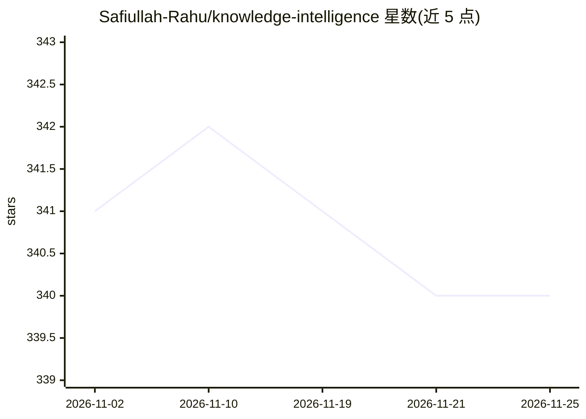

# Safiullah-Rahu/knowledge-intelligence

⭐ 340 · TypeScript · MIT · 推送 2026-11-02 · [GitHub](https://github.com/Safiullah-Rahu/knowledge-intelligence) · [官网](https://csv-ai.streamlit.app/) · 个人维护

**多租户权限感知的企业 RAG 平台，带引用的回答与 Text-to-SQL**

由 CSV-AI 分析助手演化的企业知识平台：组织接入文档、电子表格、数据库与网页/代码源，成员提问后获得带可点击引用（定位到页、表格行或数据库查询）的回答。关键机制包括 PostgreSQL 行级安全多租户、55 项细粒度权限（deny-wins）、pgvector 稠密 + BM25 稀疏检索与 RRF 融合、基于 sqlglot 的只读 Text-to-SQL 校验与审批、实时连接图谱。FastAPI + PostgreSQL/pgvector + Next.js 技术栈，MIT 许可，Docker Compose 部署；README 声明功能完整但部分实现未测试。

## 筛选速览

| 维度 | 判定 | 备注 |
|---|---|---|
| AI 角色 | `ai-native` | 本体是模型或模型工具 |
| 许可风险 | `permissive` | MIT |
| 部署形态 | `self-host` | docker 或自建部署 |
| 模型依赖 | local-ok | 支持本地模型 |
| 硬件要求 | — | 无带数字的原话,不猜 |
| 安装摩擦 | `low` | 无编译、无系统依赖或容器化 |
| 成熟度 | — | 结构信号不足 |

## 能力要点

- 30+ 文件格式、9 种分块策略、引用核验与拒绝回答
- PostgreSQL 行级安全多租户与 55 项细粒度权限
- Text-to-SQL 生成只读 SQL 并带审批门控
- 连接图谱实时展示源、索引、模型与代理

## 适用场景

- 企业内按权限隔离的知识问答，回答可溯源
- 用自然语言查询内部数据库并生成图表
- 管理组织内文档、数据源与代理的连接关系

## 场景标签

`RAG` `文档问答` `数据分析` · 领域:效率与自动化

## 证据(README 行号)

> L3: **Enterprise RAG & knowledge intelligence platform**: a multi-tenant, permission-aware knowledge platform that grew 
> L28: - **Serious RAG** — 30+ file formats with page/section/sheet/row locators, 9 chunking strategies, pgvector dense + 

## 星数曲线

2026-11-02 341 → 2026-11-25 340（-1）

---
*卡片 v1 · prompt 1.4 · 生成 2026-11-17 · 置信度 high · 依据 README sha `8383857ab408` · [字段定义](../../DATASET.md)*
