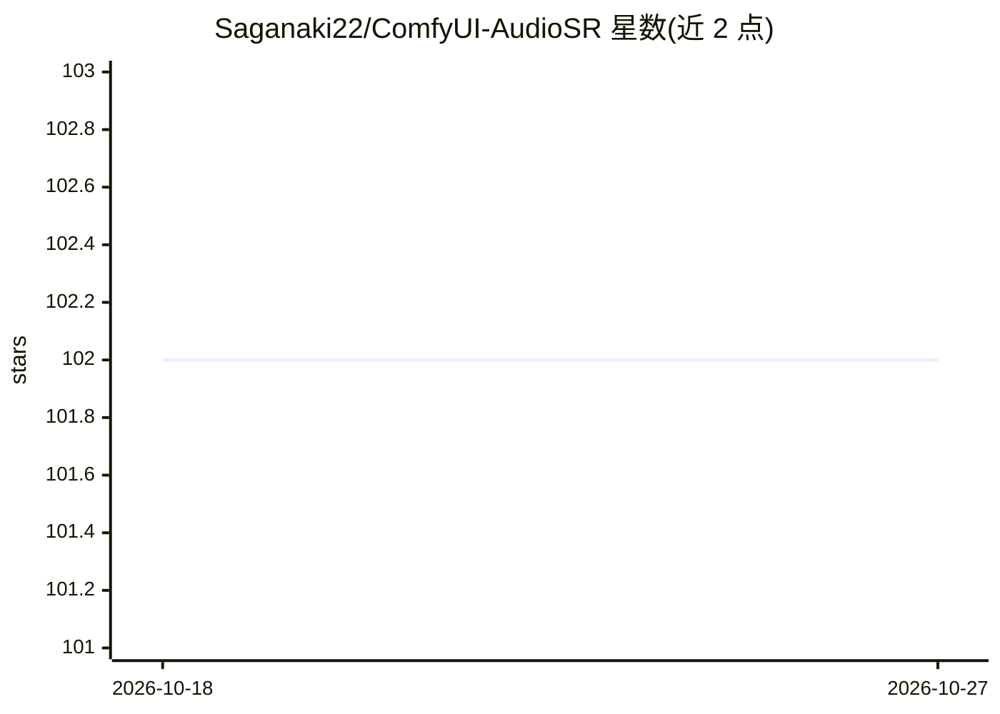

# Saganaki22/ComfyUI-AudioSR

⭐ 102 · Python · MIT · 推送 2026-02-12 · [GitHub](https://github.com/Saganaki22/ComfyUI-AudioSR) · [官网](https://huggingface.co/drbaph/AudioSR) · 个人维护

**ComfyUI 音频超分节点：用潜扩散将音频升至 48kHz**

基于 Haohe Liu 等人 AudioSR 实现的原生 ComfyUI 自定义节点，使用潜扩散模型将 8kHz-48kHz 输入音频上采样至 48kHz 并增强高频、减少低码率压缩伪影，支持单/双声道、长音频分块处理与前后频谱对比可视化。提供 sdpa/sageattn/eager 三种注意力后端、fp32/fp16/bf16 计算精度、可选 torch.compile 加速与模型卸载等显存管理选项。经 ComfyUI Manager 或 git clone 手动安装，模型需从 HuggingFace 下载放入 models 目录。要求最低 6GB VRAM、推荐 12GB RAM。

## 筛选速览

| 维度 | 判定 | 备注 |
|---|---|---|
| AI 角色 | `ai-native` | 本体是模型或模型工具 |
| 许可风险 | `permissive` | MIT |
| 部署形态 | `desktop` | 安装包/桌面程序 |
| 模型依赖 | — | README 未给出锁定关系 |
| 硬件要求 | `gpu-8g` | |
| 安装摩擦 | `medium` | 含编译或系统依赖之一 |
| 成熟度 | — | 结构信号不足 |

## 能力要点

- 潜扩散模型将任意输入采样率（8-48kHz）音频升至 48kHz
- 长音频自动分块+交叉淡出拼接，处理时长不限
- 三种注意力后端与 fp32/fp16/bf16 计算精度可选
- 内置前后频谱对比可视化与模型缓存

## 适用场景

- 在 ComfyUI 工作流中提升老录音或低码率 MP3 的音质
- 为视频制作预处理压缩音频
- 修复归档音频内容

## 场景标签

 · 领域:音频处理/AIGC 工具

## 证据(README 行号)

> L10: Native ComfyUI node for **AudioSR (Versatile Audio Super Resolution)** - Upscale any audio to 48kHz using state-of-
> L177: Upscale audio to 48kHz using the AudioSR latent diffusion model. The model analyzes low-quality audio and generate

## 星数曲线

2026-10-18 102 → 2026-10-27 102（+0）

---
*卡片 v1 · prompt 1.4 · 生成 2026-10-23 · 置信度 mid · 依据 README sha `d821b5326446` · [字段定义](../../DATASET.md)*
