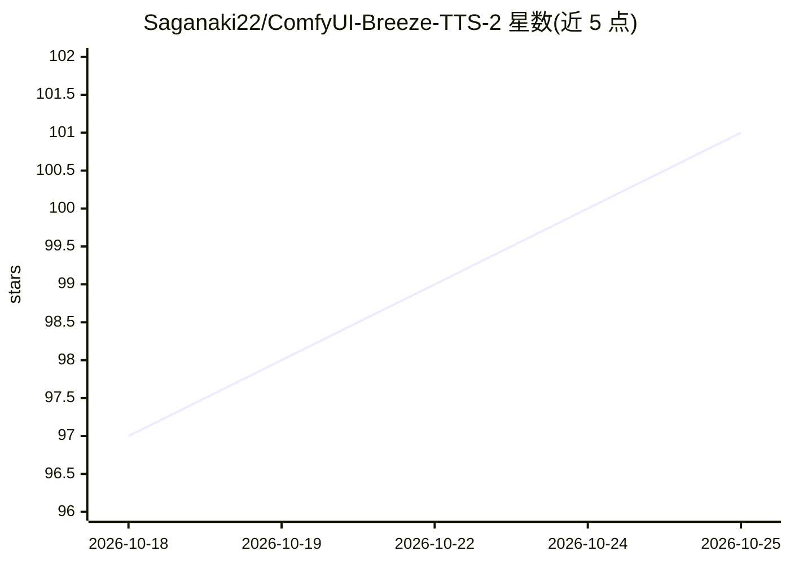

# Saganaki22/ComfyUI-Breeze-TTS-2

⭐ 105 · Python · Apache-2.0 · 推送 2026-10-21 · [GitHub](https://github.com/Saganaki22/ComfyUI-Breeze-TTS-2) · [官网](https://huggingface.co/drbaph/Breeze-TTS-2-comfyui) · 个人维护 · 中文 README

**ComfyUI 的 Breeze TTS 2 语音合成节点包**

为 ComfyUI 提供 Breeze TTS 2 模型节点的扩展包，覆盖语音克隆、自然语言语音设计、带指令的语气/情绪/语速控制三类合成方式，支持中英双语与内联拟声事件（如[笑]/(sigh)），输出 24 kHz 单声道音频。多说话者节点可接线最多 8 个说话人并解析纯文本或 JSON 对话脚本。模型提供 bf16 与三种 INT8 ConvRot 量化版本（权重 4.22–6.49 GiB），支持 AIMDO 动态显存分页与 CUDA graphs 解码模式。运行需 ComfyUI 与 Transformers 4.57/5.3+。

## 筛选速览

| 维度 | 判定 | 备注 |
|---|---|---|
| AI 角色 | `ai-native` | 本体是模型或模型工具 |
| 许可风险 | `permissive` | Apache-2.0 |
| 部署形态 | `None` |  |
| 模型依赖 | — | README 未给出锁定关系 |
| 硬件要求 | — | 无带数字的原话,不猜 |
| 安装摩擦 | `medium` | 含编译或系统依赖之一 |
| 成熟度 | — | 结构信号不足 |

## 能力要点

- 语音克隆/语音设计/语音指令控制三种合成节点
- 最多 8 说话人的多角色对话生成（文本或 JSON 脚本）
- INT8 ConvRot 量化版本，峰值显存低至约 5.21 GiB
- 内联中英拟声事件与 24 kHz 输出

## 适用场景

- 在 ComfyUI 工作流中克隆参考音频生成语音
- 用自然语言描述设计声音或控制语气情绪
- 生成多角色对话旁白与播客音频

## 场景标签

`语音合成` · 领域:内容生成

## 证据(README 行号)

> L9: Breeze TTS 2 nodes for ComfyUI: **voice clone**,
> L18: |**Breeze TTS 2 Voice Clone**|Clones a speaker from clean reference audio + its exact transcript (CFG 1.0).|
> L19: |**Breeze TTS 2 Voice Design**|Creates a voice from a natural-language description, no reference audio (CFG 4).|

## 星数曲线

2026-10-18 97 → 2026-10-25 101（+4）

---
*卡片 v1 · prompt 1.4 · 生成 2026-10-23 · 置信度 high · 依据 README sha `5dc3aef6d4a2` · [字段定义](../../DATASET.md)*
