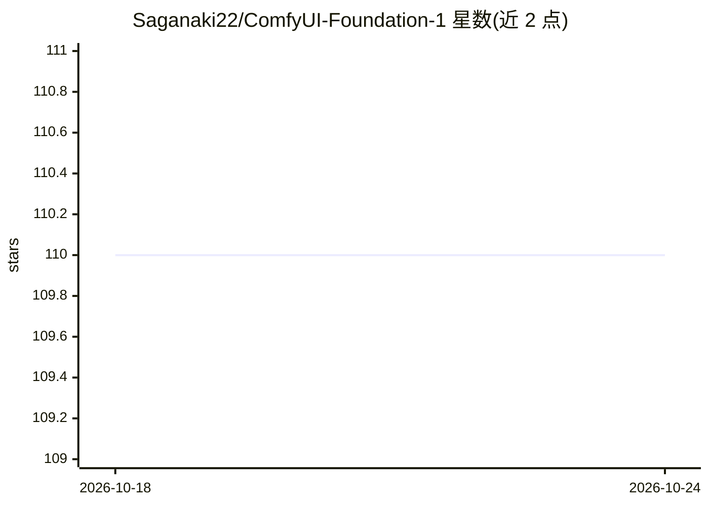

# Saganaki22/ComfyUI-Foundation-1

⭐ 110 · Python · NOASSERTION · 推送 2026-03-22 · [GitHub](https://github.com/Saganaki22/ComfyUI-Foundation-1) · [官网](https://huggingface.co/RoyalCities/Foundation-1) · 个人维护

**ComfyUI 节点：用 Foundation-1 扩散模型生成音乐采样循环**

Foundation-1 结构化文本转采样扩散模型的 ComfyUI 自定义节点封装：以乐器、音色、FX、记谱标签作为提示词，配合 BPM、小节数与 24 种调式下拉控制，生成节拍同步的音乐循环（最长 20 秒）；支持接入音频输入生成变体、模型权重从 HuggingFace 首次使用时自动下载、可选 CPU RAM 卸载。面向使用 ComfyUI 的音乐制作者。要求 NVIDIA GPU（8GB VRAM 起、CUDA 11.8+），不支持 CPU/MPS。

## 筛选速览

| 维度 | 判定 | 备注 |
|---|---|---|
| AI 角色 | `ai-native` | 本体是模型或模型工具 |
| 许可风险 | `none` | NOASSERTION |
| 部署形态 | `library` | 以包/库形式分发 |
| 模型依赖 | — | README 未给出锁定关系 |
| 硬件要求 | `gpu-8g` | |
| 安装摩擦 | `medium` | 含编译或系统依赖之一 |
| 成熟度 | — | 结构信号不足 |

## 能力要点

- 结构化标签提示（乐器/音色/FX/记谱）+ BPM/小节/调式控制生成音乐循环
- 音频输入变体生成，init_noise_level 控制变化强度
- 模型权重与 T5 编码器首次运行自动从 HuggingFace 下载
- 支持 SDPA/FlashAttention 2/SageAttention，生成后可卸载至 CPU RAM

## 适用场景

- 在 ComfyUI 中按 BPM、小节与调式生成音乐 loop
- 将自己的音频素材传入生成风格变体
- 通过标签精确控制乐器与音色进行音乐创作

## 场景标签

 · 领域:音频生成/音乐制作

## 证据(README 行号)

> L18: **Foundation-1** is a structured text-to-sample diffusion model for music production. It understands instrument ide
> L32: - Structured Text-to-Sample — Generate musical loops from structured text prompts

## 星数曲线

2026-10-18 110 → 2026-10-24 110（+0）

---
*卡片 v1 · prompt 1.4 · 生成 2026-10-23 · 置信度 mid · 依据 README sha `3b1dd37d13d6` · [字段定义](../../DATASET.md)*
