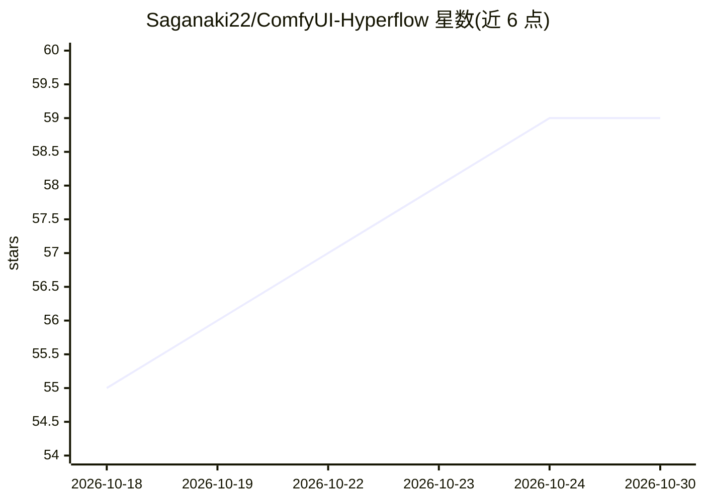

# Saganaki22/ComfyUI-Hyperflow

⭐ 59 · Python · Apache-2.0 · 推送 2026-10-14 · [GitHub](https://github.com/Saganaki22/ComfyUI-Hyperflow) · [官网](https://huggingface.co/drbaph/Hyperflow-Comfyui) · 个人维护 · 中文 README

**在 ComfyUI 中原生加载 HyperFlow 8 步 MiniMax-H3 LoRA 的节点包**

ComfyUI 自定义节点包，将 HyperFlow（Video Rebirth 的 8 步 MiniMax-H3 视频+音频 LoRA）移植到 ComfyUI 原生 MiniMax-H3 模型上，不修改 ComfyUI 核心文件。核心机制：rank-256 LoRA 与 two-time (t, r) 条件化（每步按积分区间条件化），通过 ModelPatcher 注入；输出训练好的 9 点 sigma 网格接 SamplerCustomAdvanced。支持 pruned 基座的实验性曲线拟合（内置约 34KB 拟合文件，音频/视频余弦相似度提升至 0.88/0.99），自动检测基座类型并强制匹配权重文件。限制：pruned 基座默认仅应用骨干 LoRA、偏离原配方。代码 Apache-2.0，权重属 MiniMax H3 Community License 下的模型衍生品。

## 筛选速览

| 维度 | 判定 | 备注 |
|---|---|---|
| AI 角色 | `ai-ecosystem` | LLM/agent 周边工具 |
| 许可风险 | `permissive` | Apache-2.0 |
| 部署形态 | `None` |  |
| 模型依赖 | — | README 未给出锁定关系 |
| 硬件要求 | — | 无带数字的原话,不猜 |
| 安装摩擦 | `medium` | 含编译或系统依赖之一 |
| 成熟度 | — | 结构信号不足 |

## 能力要点

- rank-256 LoRA + two-time (t, r) 条件化经 ModelPatcher 注入，不改核心文件
- 输出训练好的 9 点 sigma 网格替代调度器，官方配方用 Euler
- pruned 基座的实验性曲线拟合（FL2VA 视频 cosine 0.81→0.88，REF2VA 音频 0.93→0.99）
- download_if_missing 自动从 HuggingFace 拉取转换后权重

## 适用场景

- 在 ComfyUI 原生 MiniMax-H3 上跑 HyperFlow 8 步视频+音频生成
- 使用 pruned/curve 基座时恢复 most of the two-time 条件信号
- 配合核心 Model Sparse Attention 节点复现 Sol-Attn 稀疏注意力配方

## 场景标签

`视频生成` · 领域:内容生成

## 证据(README 行号)

> L7: ComfyUI node pack for HyperFlow — Video Rebirth's 8-step LoRA for MiniMax-H3 (video + audio), ported onto ComfyUI's 
> L11: The adapter is two things on top of the official base: a LoRA (rank 256, unmerged bf16 branches) and **two-time `(t

## 星数曲线

2026-10-18 55 → 2026-10-30 59（+4）

---
*卡片 v1 · prompt 1.4 · 生成 2026-10-24 · 置信度 high · 依据 README sha `0d028c75a94a` · [字段定义](../../DATASET.md)*
