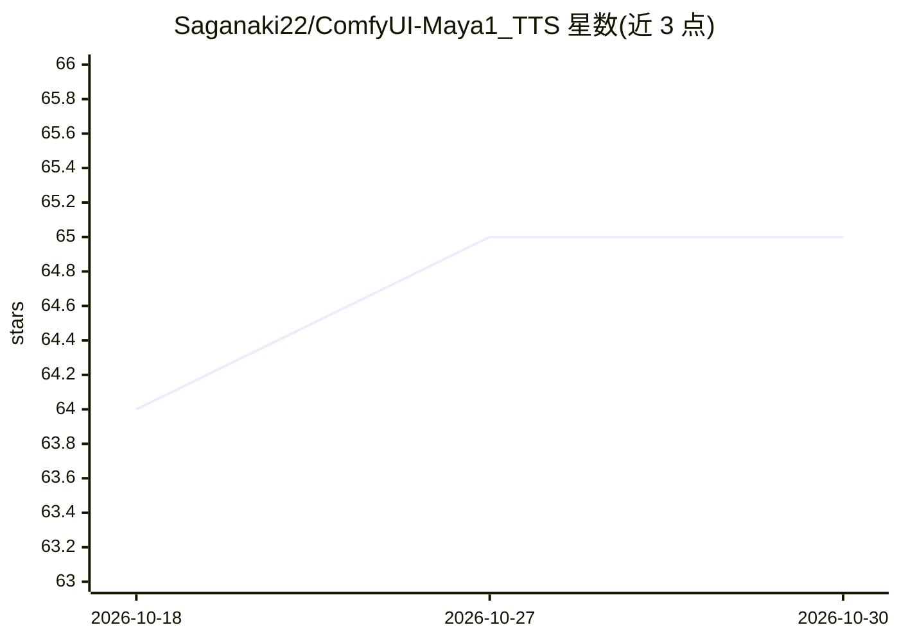

# Saganaki22/ComfyUI-Maya1_TTS

⭐ 65 · Python · Apache-2.0 · 推送 2025-11-11 · [GitHub](https://github.com/Saganaki22/ComfyUI-Maya1_TTS) · [官网](https://huggingface.co/maya-research/maya1) · 个人维护

**ComfyUI 的 Maya1 语音合成节点：情感化 TTS 与声音设计**

为 ComfyUI 提供的 Maya1（3B 参数语音模型）节点包，通过自然语言声音描述与 16 种情感标签生成 24kHz 语音，支持 4bit/8bit 量化、多种注意力机制（SDPA/Flash Attention 2/Sage）与 CPU/GPU 运行。提供带自定义画布 UI 的 AIO 节点（5 个角色预设、情感按钮、全屏编辑器）与标准控件版 Barebones 节点，安装方式为克隆到 custom_nodes 并 pip 安装依赖，模型需从 HuggingFace 下载至指定目录。量化模式标注为比 float16/bfloat16 更慢，长文本自动分块功能标注为实验性。

## 筛选速览

| 维度 | 判定 | 备注 |
|---|---|---|
| AI 角色 | `ai-native` | 本体是模型或模型工具 |
| 许可风险 | `permissive` | Apache-2.0 |
| 部署形态 | `library` | 以包/库形式分发 |
| 模型依赖 | — | README 未给出锁定关系 |
| 硬件要求 | — | 无带数字的原话,不猜 |
| 安装摩擦 | `medium` | 含编译或系统依赖之一 |
| 成熟度 | `idea` | |

## 能力要点

- 自然语言声音描述与 16 种情感标签的语音生成
- 4bit/8bit 量化支持（约 6-7GB VRAM），float16/bfloat16 约 8-9GB VRAM
- SNAC 神经编解码器实时生成 24kHz 音频，支持模型缓存与 VRAM 管理
- 自定义画布 UI：5 个角色预设、情感按钮、全屏 HTML 编辑器

## 适用场景

- 在 ComfyUI 工作流中通过文字描述生成带情感的语音
- 为视频/动画内容配角色语音（含播报员、机器人等预设）
- 显存受限时用 4bit/8bit 量化运行语音合成

## 场景标签

`语音合成` · 领域:内容生成

## 证据(README 行号)

> L5: A ComfyUI node pack for Maya1, a 3B-parameter speech model built for expressive voice generation with rich human emo
> L18: - ⚡ **Real-time Generation** with SNAC neural codec (24kHz audio)

## 星数曲线

2026-10-18 64 → 2026-10-30 65（+1）

---
*卡片 v1 · prompt 1.4 · 生成 2026-10-24 · 置信度 mid · 依据 README sha `a6a66177e809` · [字段定义](../../DATASET.md)*
