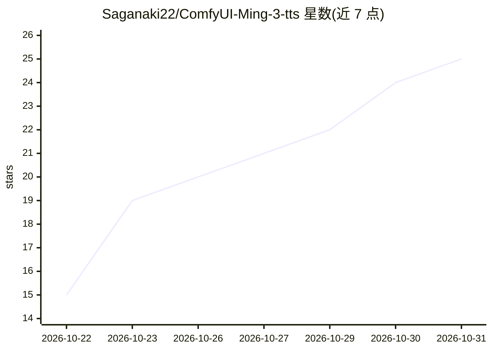

# Saganaki22/ComfyUI-Ming-3-tts

⭐ 25 · Python · MIT · 推送 2026-10-25 · [GitHub](https://github.com/Saganaki22/ComfyUI-Ming-3-tts) · [官网](https://huggingface.co/drbaph/Ming-3.0-tts-ComfyUI) · 个人维护 · 中文 README

**ComfyUI 的 Ming-3.0-tts 语音生成节点，支持 0.5B 与 Tiny 9B**

将 inclusionAI/Ming-3.0-tts 移植为 ComfyUI 自定义节点的插件：提供 Load Model、Generate、Podcast、Whisper Transcribe 等节点，覆盖内置音色、音色设计、录音克隆（含 Whisper 自动转写）、自由指令、语速/音高/音量、情感与方言（粤语/四川话）等任务，Tiny 9B 支持多说话人播客对话，输出 44.1 kHz 单声道音频。模型需从 drbaph/Ming-3.0-tts-ComfyUI 下载或开启 download_if_missing。可选 INT8 量化（0.5B 约 2.5–2.8 GiB、Tiny INT8 约 9.9 GiB CUDA 显存），CPU 可运行但较慢；MPS/ROCm/DirectML 未测试。可选 fla-core 加速 Tiny 的 KDA 内核。

## 筛选速览

| 维度 | 判定 | 备注 |
|---|---|---|
| AI 角色 | `ai-native` | 本体是模型或模型工具 |
| 许可风险 | `permissive` | MIT |
| 部署形态 | `desktop` | 安装包/桌面程序 |
| 模型依赖 | — | README 未给出锁定关系 |
| 硬件要求 | — | 无带数字的原话,不猜 |
| 安装摩擦 | `medium` | 含编译或系统依赖之一 |
| 成熟度 | — | 结构信号不足 |

## 能力要点

- 0.5B 与 Tiny 9B 双模型，支持原版与 INT8 ConvRot 量化
- 8 类生成任务：克隆、音色设计、内置音色、自由指令、基础属性、情感、方言、播客
- 本地 Whisper 转写节点用于克隆参考音频
- 跨语言克隆（中/英/德/西/法/韩/日）与内联声乐标签

## 适用场景

- 在 ComfyUI 工作流中用一句话描述生成指定音色的语音
- 用自己的录音加转写文本克隆声音
- 用 Tiny 9B 生成双说话人播客对话

## 场景标签

`语音合成` · 领域:内容生成

## 证据(README 行号)

> L7: Native ComfyUI port of Ming-3.0-tts, supporting 0.5B and Tiny 9B speech generation.
> L135: |Ming TTS Generate|Select cloning, voice design, built-in voice, freeform direction, basic attributes, emotion or 
> L137: |Ming TTS Podcast (Tiny 9B)|Native dialogue generation with growing speaker inputs and `Name: speech` lines.|

## 星数曲线

2026-10-22 15 → 2026-10-31 25（+10）

---
*卡片 v1 · prompt 1.4 · 生成 2026-10-28 · 置信度 high · 依据 README sha `02b68123f92b` · [字段定义](../../DATASET.md)*
