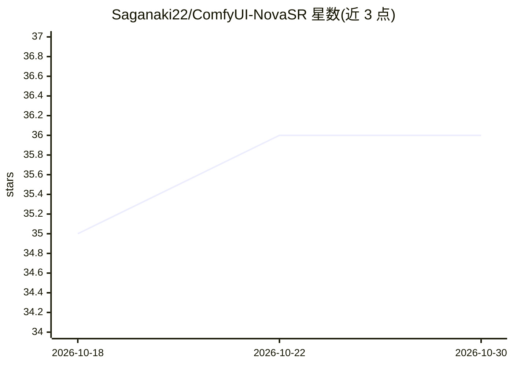

# Saganaki22/ComfyUI-NovaSR

⭐ 36 · Python · Apache-2.0 · 推送 2026-02-12 · [GitHub](https://github.com/Saganaki22/ComfyUI-NovaSR) · [官网](https://huggingface.co/drbaph/NovaSR/tree/main) · 个人维护

**ComfyUI 音频超分辨率节点：把 16kHz 音频提升到 48kHz**

基于 NovaSR 模型（约 50KB，少于 10 层 Conv1D，BigVGAN 风格 Snake 激活）的 ComfyUI 自定义节点，将低采样率/闷声音频重采样到 16kHz 后超分辨率到 48kHz，输出单声道（可切换复制为立体声），并可生成前后对比频谱图。支持 ComfyUI Load Audio 节点接受的各类格式（wav/mp3/flac/ogg 等）。经 ComfyUI Manager 或手动克隆到 custom_nodes 目录并 pip 安装依赖后使用，模型文件需从 Hugging Face 单独下载。README 给出与 FlowHigh/FlashSR/AudioSR 的速度与体积对照表。

## 筛选速览

| 维度 | 判定 | 备注 |
|---|---|---|
| AI 角色 | `ai-native` | 本体是模型或模型工具 |
| 许可风险 | `permissive` | Apache-2.0 |
| 部署形态 | `library` | 以包/库形式分发 |
| 模型依赖 | — | README 未给出锁定关系 |
| 硬件要求 | — | 无带数字的原话,不猜 |
| 安装摩擦 | `low` | 无编译、无系统依赖或容器化 |
| 成熟度 | — | 结构信号不足 |

## 能力要点

- 50KB NovaSR 模型，16kHz→48kHz 音频超分辨率
- 自动重采样、立体声转单声道、可切换立体声输出
- 生成处理前后频谱图对比
- 支持 ComfyUI 所支持的各类音频格式输入

## 适用场景

- 提升 TTS 模型输出音频的质量
- 在 ComfyUI 工作流中增强低质量通话或录音
- 修复低采样率音频数据集

## 场景标签

 · 领域:音频处理/生成式 AI 工具

## 证据(README 行号)

> L3: Ultra-fast audio super resolution custom node for ComfyUI, powered by the NovaSR model.
> L71:  - Upscale to 48kHz at 3600x realtime speed

## 星数曲线

2026-10-18 35 → 2026-10-30 36（+1）

---
*卡片 v1 · prompt 1.4 · 生成 2026-10-25 · 置信度 high · 依据 README sha `b1c60b9523d0` · [字段定义](../../DATASET.md)*
