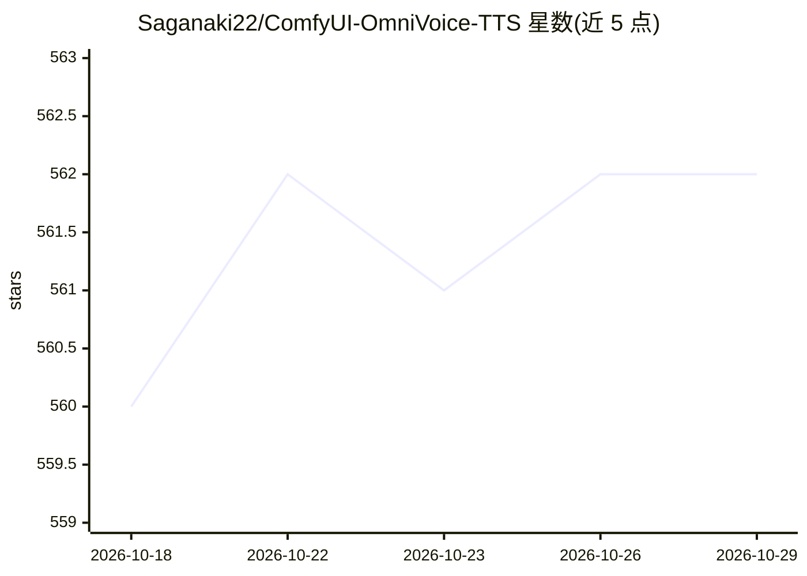

# Saganaki22/ComfyUI-OmniVoice-TTS

⭐ 562 · Python · Apache-2.0 · 推送 2026-06-11 · [GitHub](https://github.com/Saganaki22/ComfyUI-OmniVoice-TTS) · [官网](https://zhu-han.github.io/omnivoice/) · 个人维护 · 中文 README

**ComfyUI 的 OmniVoice 零样本文本转语音节点集**

为 ComfyUI 提供 5 个 OmniVoice TTS 节点：长文本转语音（智能分块）、3-15 秒参考音频的声音克隆、从文字描述生成声音（性别/年龄/音高/口音）、2-10 说话人多角色对话生成，以及 Whisper ASR 预加载节点。底层为 Qwen3 骨干的扩散式音频生成，支持 600+ 语言、非语言标签（笑声/叹气等）。可选 SageAttention CUDA 内核（SM80+），模型首次使用时自动从 HuggingFace 下载，支持 CUDA/CPU/MPS/XPU 设备与 CPU offload。经 ComfyUI Manager 或 git clone 手动安装。

## 筛选速览

| 维度 | 判定 | 备注 |
|---|---|---|
| AI 角色 | `ai-native` | 本体是模型或模型工具 |
| 许可风险 | `permissive` | Apache-2.0 |
| 部署形态 | `desktop` | 安装包/桌面程序 |
| 模型依赖 | — | README 未给出锁定关系 |
| 硬件要求 | — | 无带数字的原话,不猜 |
| 安装摩擦 | `medium` | 含编译或系统依赖之一 |
| 成熟度 | — | 结构信号不足 |

## 能力要点

- 3-15 秒参考音频的零样本声音克隆
- 从文字描述直接设计声音属性，无需参考音频
- [Speaker_N] 标签的 2-10 说话人对话生成
- SageAttention CUDA 内核支持（SM80+，可选）

## 适用场景

- 在 ComfyUI 工作流中生成多语言配音与旁白
- 用少量参考音频克隆特定音色
- 生成带非语言表达（笑声、叹气）的语音
- 制作多角色对话音频

## 场景标签

`语音合成` · 领域:内容生成

## 证据(README 行号)

> L3: **OmniVoice TTS nodes for ComfyUI** — Zero-shot multilingual text-to-speech with voice cloning and voice design. Sup
> L19: - **Voice Cloning** — Clone any voice from 3-15 seconds of reference audio

## 星数曲线

2026-10-18 560 → 2026-10-29 562（+2）

---
*卡片 v1 · prompt 1.4 · 生成 2026-10-21 · 置信度 mid · 依据 README sha `5215920b28b9` · [字段定义](../../DATASET.md)*
