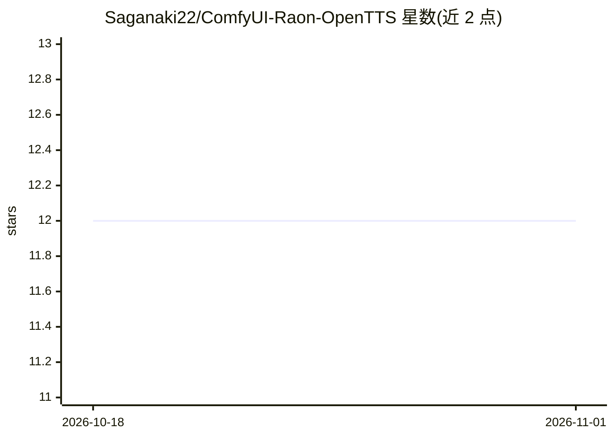

# Saganaki22/ComfyUI-Raon-OpenTTS

⭐ 12 · Python · MIT · 推送 2026-08-19 · [GitHub](https://github.com/Saganaki22/ComfyUI-Raon-OpenTTS) · [官网](https://huggingface.co/drbaph/Raon-OpenTTS-comfyui) · 个人维护 · 中文 README

**为 ComfyUI 提供 Raon-OpenTTS 零样本语音克隆节点**

KRAFTON Raon-OpenTTS（F5-TTS 风格 CFM/DiT + HiFi-GAN，16 kHz 英语）的 ComfyUI 原生节点包，面向 ComfyUI 用户。提供三个节点：模型加载（fp32/bf16/int8-convrot 三种构建，缺文件时自动从 drbaph/Raon-OpenTTS-comfyui 下载所选构建）、零样本语音克隆生成（text + ref_audio + ref_text，官方默认参数，支持长文本分块）、以及用本地 Whisper 转录参考音频。INT8 构建经 comfy-kitchen 量化内核执行，权重常驻 INT8。限制：仅英语；模型权重为 CC BY-NC 4.0 非商用许可。

## 筛选速览

| 维度 | 判定 | 备注 |
|---|---|---|
| AI 角色 | `ai-native` | 本体是模型或模型工具 |
| 许可风险 | `permissive` | MIT |
| 部署形态 | `None` |  |
| 模型依赖 | — | README 未给出锁定关系 |
| 硬件要求 | — | 无带数字的原话,不猜 |
| 安装摩擦 | `low` | 无编译、无系统依赖或容器化 |
| 成熟度 | — | 结构信号不足 |

## 能力要点

- 零样本语音克隆生成节点（text + ref_audio + ref_text）
- fp32/bf16/int8-convrot 三种权重构建，INT8 权重常驻不反量化
- 缺文件时自动从 drbaph/Raon-OpenTTS-comfyui 下载所选构建
- 内置 Whisper 转录节点生成 ref_text

## 适用场景

- 在 ComfyUI 工作流中用参考音频克隆声音合成英语语音
- 低显存场景下用 INT8 构建运行 1B 模型
- 批量长文本分块合成语音

## 场景标签

`语音合成` `语音识别` · 领域:内容生成

## 证据(README 行号)

> L7: Native ComfyUI nodes for KRAFTON Raon-OpenTTS — open-weight, open-data zero-shot voice cloning (F5-TTS-style CFM/DiT
> L23: - **Raon OpenTTS Load Model** — picks a checkpoint filename from `ComfyUI/models/raon_opentts` (both model sizes' f
> L24: - **Raon OpenTTS Generate (Voice Clone)** — zero-shot cloning: `text` + `ref_audio` + `ref_text`, with official def

## 星数曲线

2026-10-18 12 → 2026-11-01 12（+0）

---
*卡片 v1 · prompt 1.4 · 生成 2026-11-01 · 置信度 high · 依据 README sha `588a3339dcd4` · [字段定义](../../DATASET.md)*
