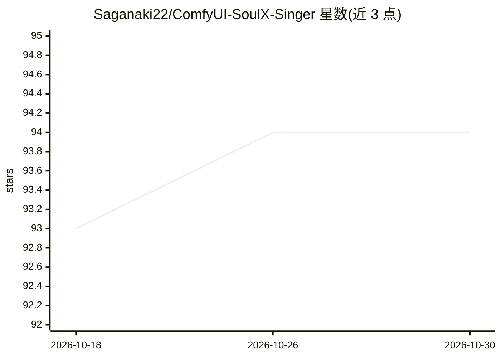

# Saganaki22/ComfyUI-SoulX-Singer

⭐ 94 · Python · Apache-2.0 · 推送 2026-02-18 · [GitHub](https://github.com/Saganaki22/ComfyUI-SoulX-Singer) · [官网](https://huggingface.co/drbaph/SoulX-Singer) · 个人维护

**ComfyUI 节点封装：零样本歌声合成模型 SoulX-Singer**

为 ComfyUI 提供 SoulX-Singer 零样本歌声合成模型的节点封装：用户输入 3-10 秒参考歌声，为未见过的歌手生成歌声；支持旋律（F0 曲线）与乐谱（MIDI 音符）双控制模式，输出音高、节奏与表现力可调的合成音频（普通话/英语/粤语）。模型与预处理器从 HuggingFace 自动下载（bf16 默认约 6.5GB，fp32 共约 9.5GB），支持 bf16/fp32 精度与 SDPA/SageAttention。Simple 节点带自动预处理，Advanced 节点支持基于 JSON 元数据与 MIDI 编辑器的手动工作流。部分预处理功能标注为实验性。

## 筛选速览

| 维度 | 判定 | 备注 |
|---|---|---|
| AI 角色 | `ai-native` | 本体是模型或模型工具 |
| 许可风险 | `permissive` | Apache-2.0 |
| 部署形态 | `library` | 以包/库形式分发 |
| 模型依赖 | — | README 未给出锁定关系 |
| 硬件要求 | — | 无带数字的原话,不猜 |
| 安装摩擦 | `medium` | 含编译或系统依赖之一 |
| 成熟度 | `idea` | |

## 能力要点

- 零样本歌声合成：3-10 秒参考样本为未见歌手生成歌声
- 旋律（F0）与乐谱（MIDI 音符）双控制模式
- 模型文件从 HuggingFace 自动下载，支持断点续传与符号链接
- Advanced 节点支持元数据 JSON 手动编辑与 MIDI 编辑器工作流

## 适用场景

- 在 ComfyUI 工作流中用自己的声音参考合成歌声
- 通过 F0 曲线或 MIDI 乐谱精确控制合成歌声的音高与节奏
- 混合音频场景下经人声分离后提取旋律再合成

## 场景标签

`语音合成` · 领域:内容生成

## 证据(README 行号)

> L20: **SoulX-Singer** is a high-fidelity, zero-shot singing voice synthesis model by SoulAI-Lab that enables users to ge
> L27: - **🎤 Zero-Shot Singing** – Generate voices for unseen singers with just a reference sample

## 星数曲线

2026-10-18 93 → 2026-10-30 94（+1）

---
*卡片 v1 · prompt 1.4 · 生成 2026-10-23 · 置信度 high · 依据 README sha `5aba39bddd73` · [字段定义](../../DATASET.md)*
