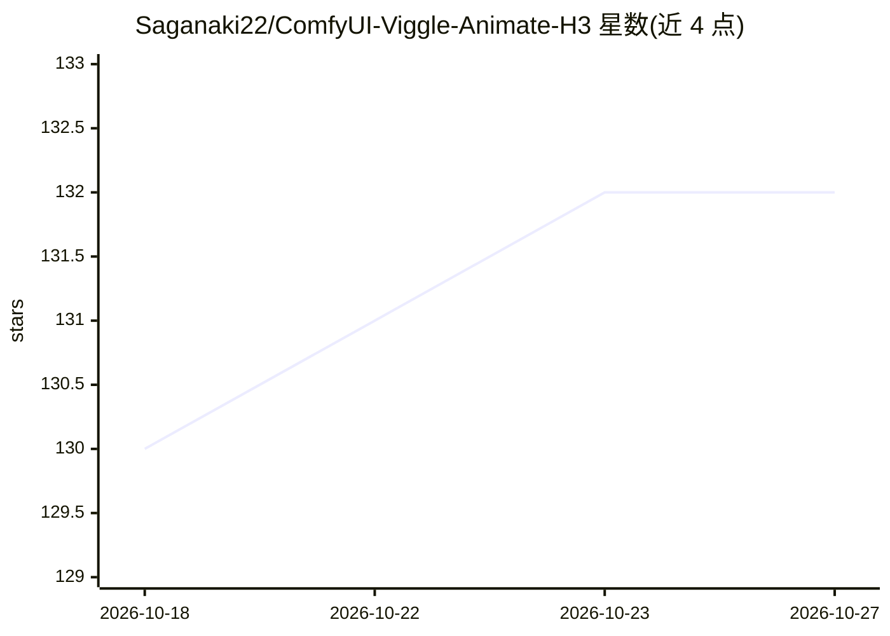

# Saganaki22/ComfyUI-Viggle-Animate-H3

⭐ 132 · Python · Apache-2.0 · 推送 2026-09-11 · [GitHub](https://github.com/Saganaki22/ComfyUI-Viggle-Animate-H3) · [官网](https://huggingface.co/drbaph/Viggle-Animate-ComfyUI) · 个人维护 · 中文 README

**ComfyUI 节点包：用参考图替换视频中角色的换装/换人视频生成**

为 ComfyUI 提供自定义节点，运行 Viggle-Animate（MiniMax-H3 ref2va 的 33.1B 全量微调模型），实现视频角色替换：以驱动视频提供运动、镜头与时序，以参考静帧提供人物身份，重新渲染视频中的表演者。无需文本编码器，条件为冻结的 362 token 嵌入；采样器经 DMD2 蒸馏，4/6/8 个 sigma 点对应不同步数。提供分窗 Chunked Sampler 与循环工作流支持长视频、磁盘检查点与断点恢复。模型权重需单独下载，diffusion 模型 21–66.3 GB。给 ComfyUI 用户使用，需 ComfyUI-KJNodes 等配套节点。

## 筛选速览

| 维度 | 判定 | 备注 |
|---|---|---|
| AI 角色 | `ai-ecosystem` | LLM/agent 周边工具 |
| 许可风险 | `permissive` | Apache-2.0 |
| 部署形态 | `None` |  |
| 模型依赖 | — | README 未给出锁定关系 |
| 硬件要求 | — | 无带数字的原话,不猜 |
| 安装摩擦 | `low` | 无编译、无系统依赖或容器化 |
| 成熟度 | — | 结构信号不足 |

## 能力要点

- 视频+参考图的角色替换推理节点（MiniMax-H3 ref2va 微调）
- DMD2 蒸馏采样：4/6/8 sigma 点对应速度/平衡/质量档位
- 分窗 Chunked Sampler 支持长视频、缓存复用与磁盘检查点恢复
- 八类节点覆盖条件构建、分块采样与潜变量组装

## 适用场景

- 把视频中的人物替换为参考图中的角色并保留动作与镜头
- 在 ComfyUI 中跑长视频生成并支持中断恢复
- 控制生成分辨率与帧率做视频换人工作流

## 场景标签

`视频生成` · 领域:内容生成

## 证据(README 行号)

> L7: ComfyUI nodes for **Viggle-Animate** — a 33.1 B full finetune of MiniMax-H3's `ref2va` transformer for **character r
> L29: The node pack includes four loop nodes for disk checkpoints, external VAE

## 星数曲线

2026-10-18 130 → 2026-10-27 132（+2）

---
*卡片 v1 · prompt 1.4 · 生成 2026-10-22 · 置信度 high · 依据 README sha `d73a6fd65282` · [字段定义](../../DATASET.md)*
