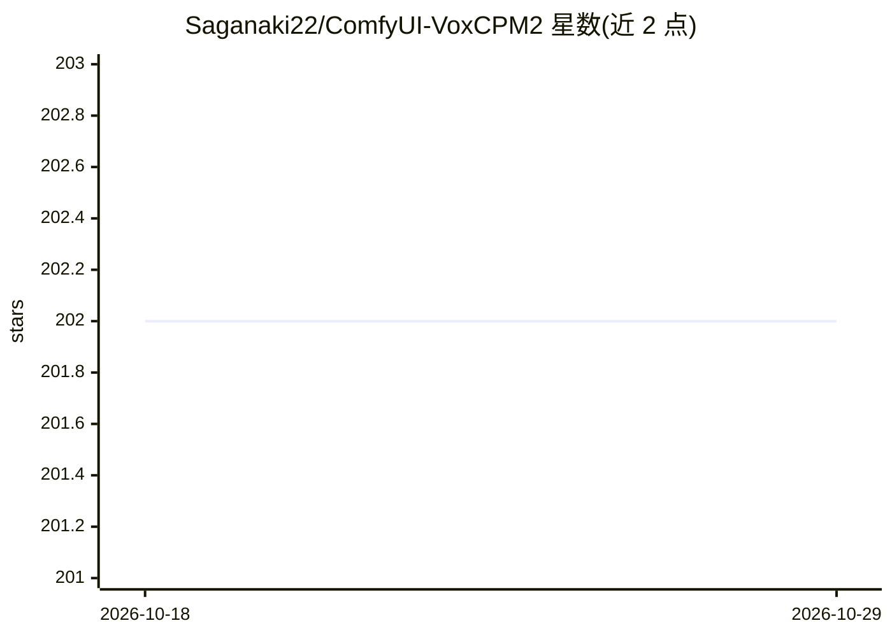

# Saganaki22/ComfyUI-VoxCPM2

⭐ 202 · Python · Apache-2.0 · 推送 2026-04-12 · [GitHub](https://github.com/Saganaki22/ComfyUI-VoxCPM2) · [官网](https://huggingface.co/openbmb/VoxCPM2) · 个人维护 · 中文 README

**ComfyUI 的 VoxCPM2 文本转语音节点：30 语言合成、克隆与 LoRA 训练**

为 ComfyUI 提供的 VoxCPM2 TTS 自定义节点集，封装 tokenizer-free 扩散自回归语音合成模型（2B 参数、48kHz 输出、30 语言免语言标签）。提供 VoxCPM2 TTS 与 Voice Clone 两个推理节点，支持自然语言音色设计、可控克隆与提供转写文本的 Ultimate Cloning；附带 LoRA 加载与 ComfyUI 内原生 LoRA 训练管线（训练配置、数据集制作、训练器节点）。可选 SenseVoiceSmall ASR 自动转写（需 funasr）与 ZipEnhancer 降噪（需 modelscope）。限制：参考音频上限 50 秒；禁止用于冒充与欺诈。

## 筛选速览

| 维度 | 判定 | 备注 |
|---|---|---|
| AI 角色 | `ai-ecosystem` | LLM/agent 周边工具 |
| 许可风险 | `permissive` | Apache-2.0 |
| 部署形态 | `library` | 以包/库形式分发 |
| 模型依赖 | — | README 未给出锁定关系 |
| 硬件要求 | — | 无带数字的原话,不猜 |
| 安装摩擦 | `medium` | 含编译或系统依赖之一 |
| 成熟度 | — | 结构信号不足 |

## 能力要点

- 两个推理节点：零样本 TTS 与可控/Ultimate 声音克隆
- 自然语言音色设计，无需参考音频
- ComfyUI 内原生 LoRA 训练管线与 LoRA 推理加载
- 可选 SenseVoiceSmall ASR 自动转写与 ZipEnhancer 参考音频降噪
- 48kHz 输出、30 种语言，模型由 ComfyUI 自动下载管理以节省 VRAM

## 适用场景

- 在 ComfyUI 工作流中把文本合成为 30 种语言的 48kHz 语音
- 用短参考音频克隆声音并加风格控制
- 在 ComfyUI 内为自己的音色训练 LoRA 适配器

## 场景标签

`语音合成` `微调` · 领域:内容生成

## 证据(README 行号)

> L5:  ComfyUI nodes for VoxCPM2 — tokenizer-free, diffusion autoregressive Text-to-Speech.
> L22: This custom node provides two inference nodes and a full LoRA training pipeline, all integrated directly into Comfy

## 星数曲线

2026-10-18 202 → 2026-10-29 202（+0）

---
*卡片 v1 · prompt 1.4 · 生成 2026-10-22 · 置信度 high · 依据 README sha `0ac4962cd37a` · [字段定义](../../DATASET.md)*
