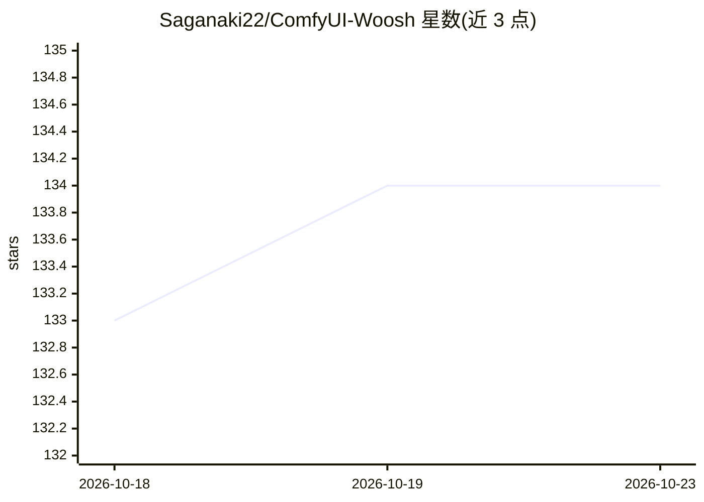

# Saganaki22/ComfyUI-Woosh

⭐ 134 · Python · MIT · 推送 2026-05-07 · [GitHub](https://github.com/Saganaki22/ComfyUI-Woosh) · [官网](https://huggingface.co/drbaph/Woosh) · 个人维护 · 中文 README

**ComfyUI 音效生成节点：用 Woosh 模型做文本/视频转音频**

ComfyUI 自定义节点集，封装 Sony AI 的 Woosh 音效基础模型，提供文本转音频（Flow/DFlow）与视频转音频（VFlow/DVFlow）能力，含蒸馏版 4 步快速生成。节点支持 CLAP 文本条件、GPU/CPU 动态显存卸载与生成后强制卸载。Woosh 库随节点打包，无需 pip 安装独立库。模型权重需从 HuggingFace 下载放入 ComfyUI/models/woosh/，基础模型约需 8-12 GB 显存，蒸馏版约 4-6 GB，CPU 卸载下约 2-4 GB。面向 ComfyUI 工作流用户。

## 筛选速览

| 维度 | 判定 | 备注 |
|---|---|---|
| AI 角色 | `ai-native` | 本体是模型或模型工具 |
| 许可风险 | `permissive` | MIT |
| 部署形态 | `library` | 以包/库形式分发 |
| 模型依赖 | — | README 未给出锁定关系 |
| 硬件要求 | — | 无带数字的原话,不猜 |
| 安装摩擦 | `medium` | 含编译或系统依赖之一 |
| 成熟度 | — | 结构信号不足 |

## 能力要点

- 文本转音频与视频转音频（Flow/DFlow/VFlow/DVFlow 四种模型）
- DFlow/DVFlow 蒸馏模型 4 步快速生成
- GPU/CPU 动态显存卸载与生成后强制卸载
- Woosh 库内置打包，不污染 torch 环境

## 适用场景

- 在 ComfyUI 工作流中用文字描述生成音效
- 为无声视频自动生成配乐音效
- 显存受限时用蒸馏模型生成音频

## 场景标签

`多模态` · 领域:感知与多模态

## 证据(README 行号)

> L3: **Sound effect generation nodes for ComfyUI** — Text-to-audio and video-to-audio using Sony AI's Woosh foundation mo
> L15: - **Text-to-Audio** — Generate sound effects from text descriptions (Flow/DFlow)
> L16: - **Video-to-Audio** — Generate audio from video frames (VFlow/DVFlow)

## 星数曲线

2026-10-18 133 → 2026-10-23 134（+1）

---
*卡片 v1 · prompt 1.4 · 生成 2026-10-22 · 置信度 mid · 依据 README sha `d5860fb52595` · [字段定义](../../DATASET.md)*
