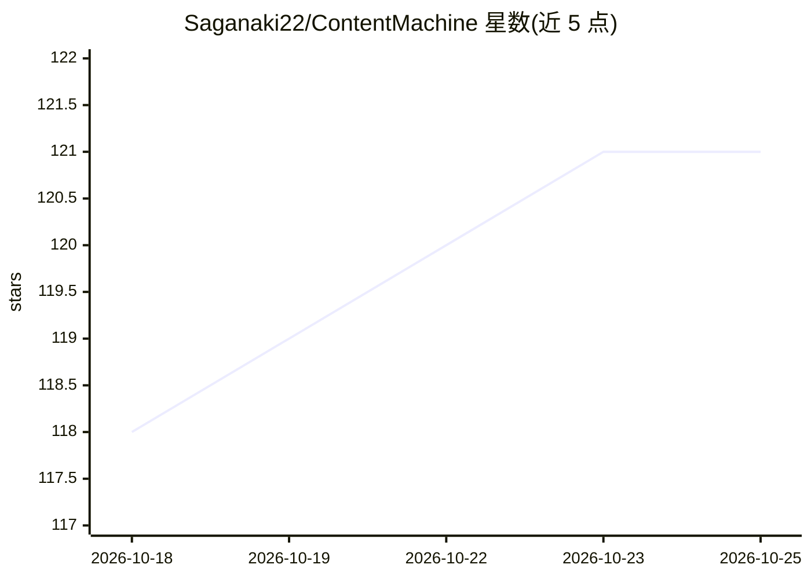

# Saganaki22/ContentMachine

⭐ 122 · JavaScript · Apache-2.0 · 推送 2026-03-02 · [GitHub](https://github.com/Saganaki22/ContentMachine) · [官网](http://drbaph.is-a.dev/ContentMachine/) · 个人维护

**从单一主题生成纪录式视频的端到端 AI 流水线应用**

面向内容创作者、纪录片作者与教育者的本地运行 Web 应用：输入一个主题，流水线自动完成历史故事调研、场景规划、图像生成（每场景 4 个变体）、视频片段生成、旁白配音、YouTube 元数据与缩略图，最终打包为 ZIP。支持 Replicate、Gemini（已测试）与 fal.ai、ElevenLabs（已实现但未完全验证），另支持本地 TTS。提供暂停/恢复、逐项重生成、版本历史、会话自动保存与 7 个阶段可编辑系统提示词。作者实测一条 4:30 视频成本约 28 美元；需 Node.js 18+ 与至少一个 LLM、一个图像提供商的 API key。

## 筛选速览

| 维度 | 判定 | 备注 |
|---|---|---|
| AI 角色 | `ai-native` | 本体是模型或模型工具 |
| 许可风险 | `permissive` | Apache-2.0 |
| 部署形态 | `None` |  |
| 模型依赖 | — | README 未给出锁定关系 |
| 硬件要求 | — | 无带数字的原话,不猜 |
| 安装摩擦 | `low` | 无编译、无系统依赖或容器化 |
| 成熟度 | `idea` | |

## 能力要点

- 6 步流水线：故事→场景→图像→视频→音频→导出，可暂停/恢复
- 多提供商接入：Replicate/Gemini（已测试）、fal.ai/ElevenLabs（未完全验证）+ 本地 TTS
- 每场景 4 个图像变体与图像/视频/缩略图的完整版本历史
- API key 存于浏览器 localStorage，7 个流水线阶段的系统提示词均可编辑

## 适用场景

- 我一个人想做出成包的纪录式 YouTube 视频，不想组制作团队
- 批量生成分镜图像、视频片段和配音，导出 ZIP 交给剪辑软件
- 通过上传角色参考图保持全片人物外观一致

## 场景标签

`视频生成` `图像生成` `语音合成` · 领域:内容生成

## 证据(README 行号)

> L41: ContentMachine automates the entire documentary video production workflow using state-of-the-art AI. Give it a topi
> L43: Built for **content creators, documentarians, educators, and hobbyists** who want to produce high-quality, cinemati

## 星数曲线

2026-10-18 118 → 2026-10-25 121（+3）

---
*卡片 v1 · prompt 1.4 · 生成 2026-10-23 · 置信度 high · 依据 README sha `361dbc01fa9a` · [字段定义](../../DATASET.md)*
