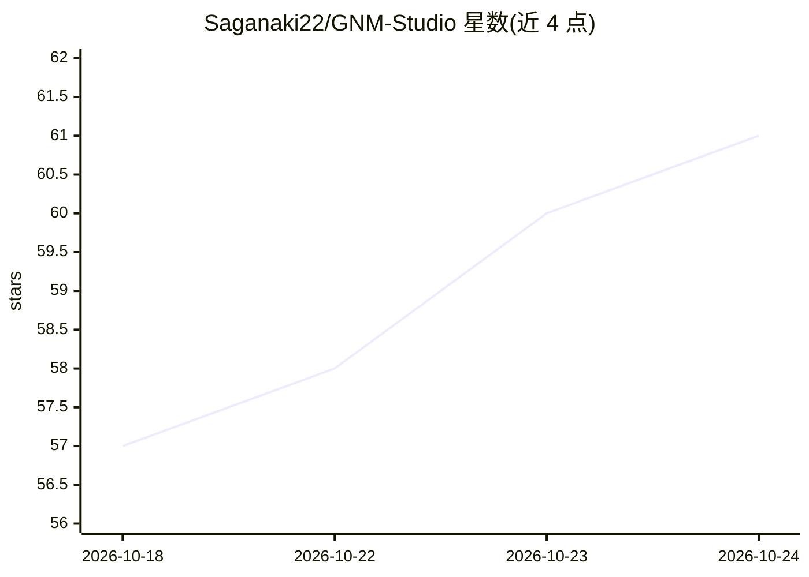

# Saganaki22/GNM-Studio

⭐ 61 · JavaScript · Apache-2.0 · 推送 2026-07-22 · [GitHub](https://github.com/Saganaki22/GNM-Studio) · [官网](http://drbaph.is-a.dev/GNM-Studio/) · 个人维护 · 中文 README

**本地优先的 Google GNM 头部创建与摄像头面捕动画桌面/网页工作室**

面向个人创作者的 Windows 便携应用与 GitHub Pages 网页版：用 MediaPipe Face Landmarker 从摄像头驱动 Google GNM Head v3 或 MIT FaceCap 52 头部模型，支持 478 面部关键点与 52 blendshape 追踪、中性表情校准、平滑滤波、种子化身份生成与实验性照片引导 Custom Head 拟合（含 DINOv3 双视角验证）。可录制动作/视频并导出 JSON、GLB（供 Blender）与 MP4。桌面版将全部模型内嵌，无需 Python/Node.js/Rust/CUDA；处理在本地进行，不上传摄像头画面。

## 筛选速览

| 维度 | 判定 | 备注 |
|---|---|---|
| AI 角色 | `ai-native` | 本体是模型或模型工具 |
| 许可风险 | `permissive` | Apache-2.0 |
| 部署形态 | `desktop` | 安装包/桌面程序 |
| 模型依赖 | — | README 未给出锁定关系 |
| 硬件要求 | `cpu-ok` | |
| 安装摩擦 | `medium` | 含编译或系统依赖之一 |
| 成熟度 | `idea` | |

## 能力要点

- MediaPipe 摄像头面部捕捉：478 关键点、52 blendshape、GPU 优先且支持 CPU 回退
- GNM Head v3（17,821 顶点）与 FaceCap 52 头像及种子化身份生成
- 实验性照片引导 Custom Head 拟合，照片不上传
- 导出 JSON/GLB（Blender）/MP4，桌面版模型全部内嵌离线运行

## 适用场景

- 用摄像头做面部动作捕捉并驱动 3D 头部
- 生成和编辑 GNM 身份与表情用于动画
- 将面捕结果导出到 Blender 继续制作

## 场景标签

 · 领域:计算机视觉/动画创作工具

## 证据(README 行号)

> L21: GNM Studio `1.4.0` combines Google GNM Head v3, the MIT FaceCap 52 avatar, MediaPipe Face Landmarker,
> L96: - MediaPipe webcam tracking with 478 face landmarks, 52 tracking blendshapes,
> L24: can drive a head from a webcam, record facial motion and video, and export

## 星数曲线

2026-10-18 57 → 2026-10-24 61（+4）

---
*卡片 v1 · prompt 1.4 · 生成 2026-10-24 · 置信度 mid · 依据 README sha `0d2a971bca1a` · [字段定义](../../DATASET.md)*
