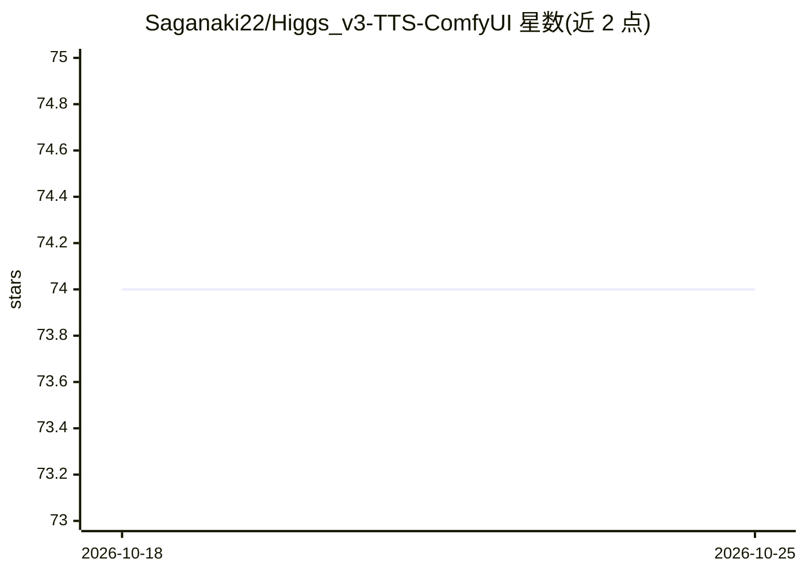

# Saganaki22/Higgs_v3-TTS-ComfyUI

⭐ 74 · Python · MIT · 推送 2026-09-05 · [GitHub](https://github.com/Saganaki22/Higgs_v3-TTS-ComfyUI) · [官网](https://huggingface.co/bosonai/higgs-audio-v3-tts-4b) · 个人维护 · 中文 README

**在 ComfyUI 中运行 Higgs Audio v3 多语种 TTS 的节点包**

为 bosonai/higgs-audio-v3-tts-4b 提供原生进程内推理的 ComfyUI 节点包：本地加载 Transformers Qwen3 骨干与 Higgs audio-token 模块，支持 100 语种对话式 TTS、参考音频零样本声音克隆、提示内情感/风格/韵律/音效标签、长文本分块、2-6 说话人多角色对话及 Whisper 参考音频转写。兼容 Transformers 5.3.0-5.5.0；模型约 9.31 GB，建议 11 GB 以上 VRAM，支持 AIMDO DynamicVRAM 分页。上游模型限研究与非商业使用。

## 筛选速览

| 维度 | 判定 | 备注 |
|---|---|---|
| AI 角色 | `ai-native` | 本体是模型或模型工具 |
| 许可风险 | `permissive` | MIT |
| 部署形态 | `desktop` | 安装包/桌面程序 |
| 模型依赖 | — | README 未给出锁定关系 |
| 硬件要求 | `gpu-8g` | |
| 安装摩擦 | `medium` | 含编译或系统依赖之一 |
| 成熟度 | — | 结构信号不足 |

## 能力要点

- 原生进程内加载 Qwen3 骨干 + Higgs audio-token 模块，不依赖远程 AutoModel
- 零样本声音克隆与 2-6 说话人多角色对话节点
- 内联情感/风格/韵律/音效标签，长文本分块保留标签
- whisper-large-v3-turbo 参考音频转写节点（自动下载）

## 适用场景

- 在 ComfyUI 工作流中直接生成多语种语音或克隆参考音色
- 用内联标签控制情感、停顿与音效制作有声内容
- 多人对话脚本配多参考音色生成播客式音频

## 场景标签

`语音合成` · 领域:内容生成

## 证据(README 行号)

> L9: ComfyUI nodes for bosonai/higgs-audio-v3-tts-4b: multilingual conversational TTS, zero-shot voice cloning, inline em
> L20: - **Native in-process inference** - Uses the local Transformers Qwen3 backbone plus Higgs audio-token embedding/hea
> L21: - **ComfyUI AUDIO in/out** - Reference voices and generated audio use standard ComfyUI `AUDIO`.

## 星数曲线

2026-10-18 74 → 2026-10-25 74（+0）

---
*卡片 v1 · prompt 1.4 · 生成 2026-10-24 · 置信度 high · 依据 README sha `c030d3c5729d` · [字段定义](../../DATASET.md)*
