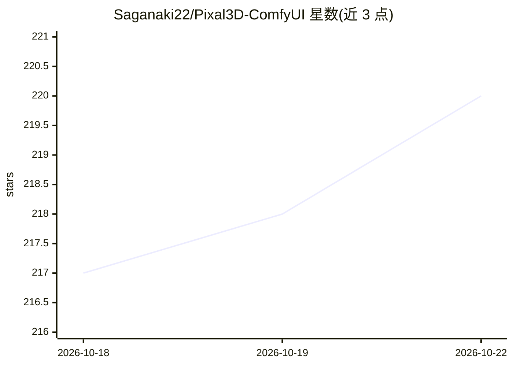

# Saganaki22/Pixal3D-ComfyUI

⭐ 219 · Python · MIT · 推送 2026-06-12 · [GitHub](https://github.com/Saganaki22/Pixal3D-ComfyUI) · [官网](https://ldyang694.github.io/projects/pixal3d/) · 个人维护 · 中文 README

**ComfyUI 图生 3D 节点：本地运行 TencentARC Pixal3D 并导出带纹理 GLB**

ComfyUI 自定义节点集合，封装 TencentARC/Pixal3D 模型在本地执行图像到 3D 生成，提供环境检查、模型加载、手动相机控制（FOV/距离/网格缩放）、带纹理 GLB 导出与模型卸载六个节点。要求 CUDA GPU（不支持纯 CPU），依赖 FlashAttention 2/3、多个 Pixal3D CUDA 内核 wheel 及 NATTEN（可选，缺失时可回退 DINO 投影特征）。Windows 提供预编译 wheel 安装路径与 VRAM 分级配置，模型权重需手动下载或自动下载。

## 筛选速览

| 维度 | 判定 | 备注 |
|---|---|---|
| AI 角色 | `ai-native` | 本体是模型或模型工具 |
| 许可风险 | `permissive` | MIT |
| 部署形态 | `desktop` | 安装包/桌面程序 |
| 模型依赖 | — | README 未给出锁定关系 |
| 硬件要求 | `cpu-ok` | |
| 安装摩擦 | `medium` | 含编译或系统依赖之一 |
| 成熟度 | — | 结构信号不足 |

## 能力要点

- 图像到 3D 生成并导出带纹理 .glb
- 手动相机控制（FOV、距离、网格缩放）与 Scene/POV 预览
- NAF 缺失 CUDA NATTEN 时的回退模式与多档 VRAM 配置
- 非方形输入自动补边为方形，避免拉伸

## 适用场景

- 在 ComfyUI 工作流中从单张图片生成 3D 模型
- 控制相机参数生成指定视角的 3D 资产
- 导出可调面数与纹理尺寸的 GLB 供预览使用

## 场景标签

 · 领域:3D 生成/ComfyUI 生态

## 证据(README 行号)

> L3: ComfyUI custom nodes for TencentARC/Pixal3D: image-to-3D generation, textured GLB export, FlashAttention 2/3 selecti
> L190: |Pixal3D Image To 3D|Runs image-to-3D generation|

## 星数曲线

2026-10-18 217 → 2026-10-22 220（+3）

---
*卡片 v1 · prompt 1.4 · 生成 2026-10-22 · 置信度 high · 依据 README sha `0f6c7b79baae` · [字段定义](../../DATASET.md)*
