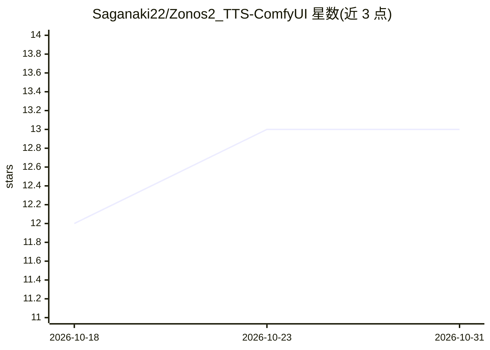

# Saganaki22/Zonos2_TTS-ComfyUI

⭐ 13 · Python · MIT · 推送 2026-06-14 · [GitHub](https://github.com/Saganaki22/Zonos2_TTS-ComfyUI) · [官网](https://huggingface.co/drbaph/ZONOS2-BF16) · 个人维护 · 中文 README

**在 ComfyUI 中运行 Zyphra ZONOS2 的 TTS 与零样本声音克隆节点包**

面向 ComfyUI 用户的 ZONOS2 文本转语音自定义节点包：原生进程内 PyTorch 实现，Windows/Linux 可用，支持零样本音频声音克隆（无需参考文本，经 2048 维 ECAPA-TDNN 说话人嵌入）、BF16 与混合 FP8 检查点、FlashAttention/SDPA 注意力后端，以及语速、响度、SNR 等条件控制。模型注册到 ComfyUI/AIMDO 内存管理，切换模型或精度时自动卸载重载。限制：要求 transformers>=5.0.0,<=5.12.0，不支持 4.x；参考音频上限 60 秒。

## 筛选速览

| 维度 | 判定 | 备注 |
|---|---|---|
| AI 角色 | `ai-ecosystem` | LLM/agent 周边工具 |
| 许可风险 | `permissive` | MIT |
| 部署形态 | `desktop` | 安装包/桌面程序 |
| 模型依赖 | — | README 未给出锁定关系 |
| 硬件要求 | — | 无带数字的原话,不猜 |
| 安装摩擦 | `medium` | 含编译或系统依赖之一 |
| 成熟度 | — | 结构信号不足 |

## 能力要点

- 零样本声音克隆：仅需 5–30 秒参考音频，无需参考文本
- BF16（约 14.3 GiB）与混合 FP8（9.78 GiB）两种检查点，自动按需下载
- FlashAttention 自动选择并以 PyTorch SDPA 为回退
- 模型与解码器注册为真实 PyTorch 模块，纳入 ComfyUI/AIMDO 内存管理

## 适用场景

- 在 ComfyUI 工作流中生成多语言语音
- 用自己拥有的参考音频做零样本声音克隆
- 显存受限时用混合 FP8 检查点运行 ZONOS2

## 场景标签

`语音合成` · 领域:内容生成

## 证据(README 行号)

> L3: ComfyUI custom nodes for Zyphra/ZONOS2, with text-to-speech, audio-only voice cloning, SDPA and FlashAttention infer
> L39: - Native in-process PyTorch implementation for Windows and Linux.
> L47: - Real tensor registration with ComfyUI model management and AIMDO.

## 星数曲线

2026-10-18 12 → 2026-10-31 13（+1）

---
*卡片 v1 · prompt 1.4 · 生成 2026-10-31 · 置信度 mid · 依据 README sha `4659d00d1feb` · [字段定义](../../DATASET.md)*
