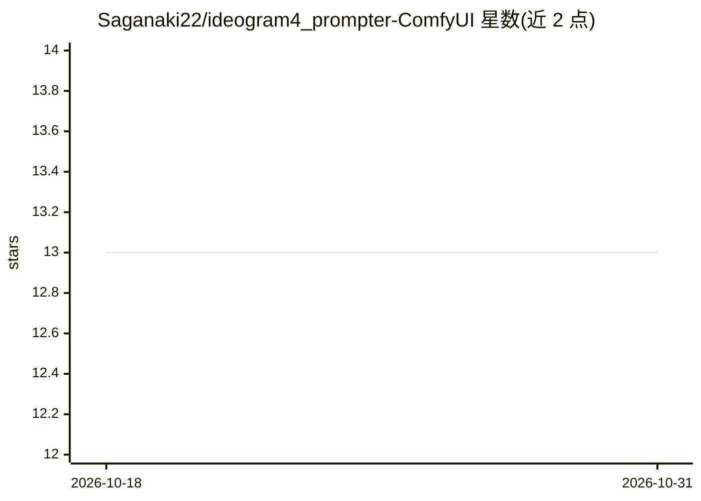

# Saganaki22/ideogram4_prompter-ComfyUI

⭐ 13 · Python · MIT · 推送 2026-06-04 · [GitHub](https://github.com/Saganaki22/ideogram4_prompter-ComfyUI) · [官网](https://ideogram.ai/manage-api) · 个人维护 · 中文 README

**ComfyUI 自定义节点：调用 Ideogram Magic Prompt API 生成结构化提示词**

面向 ComfyUI 用户的自定义节点包，包含两个节点：Ideogram 4 Magic Prompt 将用户基础提示词发送到 Ideogram 的免费 Magic Prompt API，返回结构化 JSON 提示词与解析后的宽高比；Resolution Selector 根据宽高比与目标百万像素计算对齐到 8 倍数的宽高。需要 Ideogram API key 与网络连接，API key、提示词与宽高比会发送至 Ideogram。无需额外 Python 依赖，通过 ComfyUI Manager 或手动 git clone 安装。

## 筛选速览

| 维度 | 判定 | 备注 |
|---|---|---|
| AI 角色 | `ai-ecosystem` | LLM/agent 周边工具 |
| 许可风险 | `permissive` | MIT |
| 部署形态 | `None` |  |
| 模型依赖 | — | README 未给出锁定关系 |
| 硬件要求 | — | 无带数字的原话,不猜 |
| 安装摩擦 | `low` | 无编译、无系统依赖或容器化 |
| 成熟度 | — | 结构信号不足 |

## 能力要点

- Magic Prompt 节点调用 Ideogram 免费 API 返回结构化 JSON 提示词
- Resolution Selector 按目标百万像素计算宽高（对齐 8 的倍数）
- 支持 17 种 Ideogram 4 原生宽高比含 AUTO 模式
- 无额外 Python 依赖，附示例工作流

## 适用场景

- 在 ComfyUI 中为 Ideogram 4 生成合规的结构化 JSON 提示词
- 自动确定宽高比并计算采样分辨率
- 省去手写或调试 JSON 提示词 schema 的过程

## 场景标签

`提示工程` · 领域:Agent 开发

## 证据(README 行号)

> L15: Simple ComfyUI custom nodes for Ideogram 4 Magic Prompt and Ideogram 4 aspect-ratio resolution selection.
> L23: The Magic Prompt API was available, free to use, and a good fit for ComfyUI workflows. Instead of spending local co

## 星数曲线

2026-10-18 13 → 2026-10-31 13（+0）

---
*卡片 v1 · prompt 1.4 · 生成 2026-10-31 · 置信度 high · 依据 README sha `240637288f8e` · [字段定义](../../DATASET.md)*
