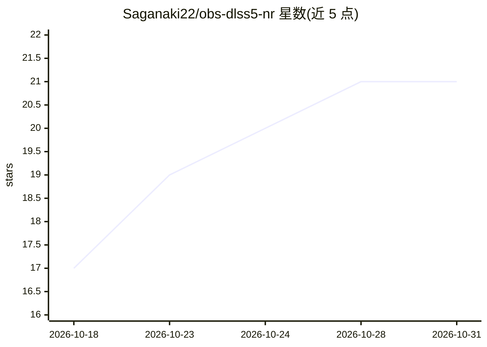

# Saganaki22/obs-dlss5-nr

⭐ 21 · C++ · GPL-2.0 · 推送 2026-10-21 · [GitHub](https://github.com/Saganaki22/obs-dlss5-nr) · 个人维护

**在 OBS 任意视频源上运行 NVIDIA DLSS 5 神经渲染的滤镜插件**

非官方 OBS Studio 滤镜插件，调用 NVIDIA DLSS 5 Neural Rendering（NGX feature 18）对 Game Capture、媒体源、摄像头等任意视频源做实时神经渲染处理，提供 Default/Natural/Cinematic 三种风格与强度、色调、时域模式等逐帧参数。需用户自行获取并放置 NVIDIA 专有的 nvngx_dlssnr.dll 运行时文件（发行包不含）。仅支持 Windows x64 与 RTX GPU（官方支持 50 系，旧卡未验证），Linux/macOS 构建为空模块。Linux/macOS 为 no-op。GPL-2.0 许可。

## 筛选速览

| 维度 | 判定 | 备注 |
|---|---|---|
| AI 角色 | `ai-native` | 本体是模型或模型工具 |
| 许可风险 | `viral` | GPL-2.0 |
| 部署形态 | `desktop` | 安装包/桌面程序 |
| 模型依赖 | — | README 未给出锁定关系 |
| 硬件要求 | — | 无带数字的原话,不猜 |
| 安装摩擦 | `high` | 编译与系统依赖俱全 |
| 成熟度 | `idea` | |

## 能力要点

- 对任意 OBS 视频源实时运行 DLSS 5 神经渲染
- Temporal Mode 用 NVIDIA Optical Flow 估计运动矢量提升时域稳定性
- Smooth/Low latency 两种处理模式与处理分辨率选择（默认 1080p）
- NGX 运行时错误时回退为直通视频的失效保护设计

## 适用场景

- 直播中用 RTX 50 系显卡对摄像头画面做 AI 神经渲染增强
- 降低 4K 源的处理分辨率以提升处理帧率
- 为 OBS 视频源添加 DLSS NR 风格化滤镜效果

## 场景标签

`图像视频处理` · 领域:感知与多模态

## 证据(README 行号)

> L3: **Unofficial DLSS 5 Neural Rendering filter for OBS Studio** — runs NVIDIA DLSS 5 NR (NGX feature 18) on any video s
> L10: - DLSS 5 Neural Rendering on any OBS video source, live

## 星数曲线

2026-10-18 17 → 2026-10-31 21（+4）

---
*卡片 v1 · prompt 1.4 · 生成 2026-10-28 · 置信度 high · 依据 README sha `2b8e9a82650a` · [字段定义](../../DATASET.md)*
