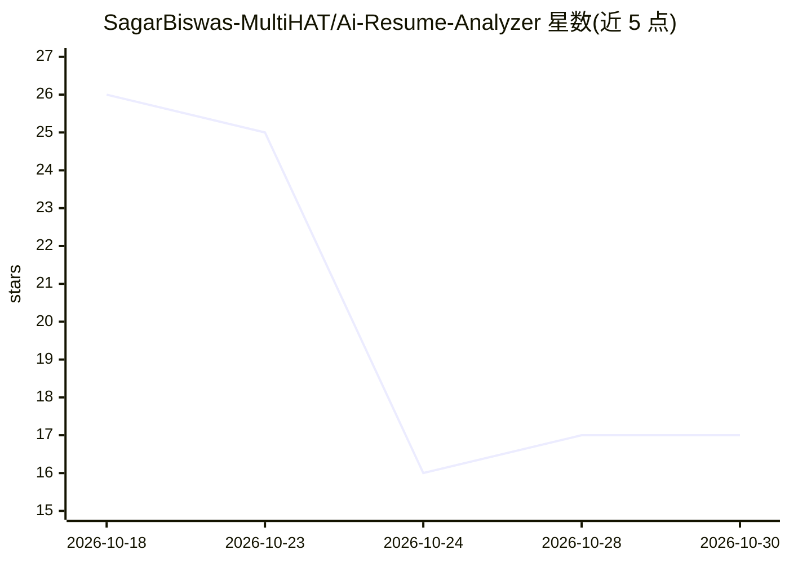

# SagarBiswas-MultiHAT/Ai-Resume-Analyzer

⭐ 17 · Python · MIT · 推送 2026-02-24 · [GitHub](https://github.com/SagarBiswas-MultiHAT/Ai-Resume-Analyzer) · 个人维护

**本地 Flask 简历分析应用：用 LLM 给出结构化修改建议**

本地优先的 Flask 单页 Web 应用：用户上传 PDF/DOCX 简历（限 5 MB），后端用 pdfminer/python-docx 抽取文本，经 OpenAI 兼容客户端调用 Groq 模型（支持重试与多模型回退），返回 1-10 评分、逐条建议、关键词缺口、改写摘要与要点示例及优先修复顺序，UI 提供拖拽上传、暗色模式、复制与文本报告下载。需配置 GROQ_API_KEY，CORS 默认限 localhost，临时文件处理后删除。提供 Docker 构建运行方式。

## 筛选速览

| 维度 | 判定 | 备注 |
|---|---|---|
| AI 角色 | `ai-native` | 本体是模型或模型工具 |
| 许可风险 | `permissive` | MIT |
| 部署形态 | `self-host` | docker 或自建部署 |
| 模型依赖 | locked-api |  |
| 硬件要求 | — | 无带数字的原话,不猜 |
| 安装摩擦 | `low` | 无编译、无系统依赖或容器化 |
| 成熟度 | — | 结构信号不足 |

## 能力要点

- PDF/DOCX 文本抽取（pdfminer/python-docx）+ LLM 结构化分析
- Groq OpenAI 兼容客户端，带重试与模型回退
- 输出评分、关键词缺口、改写示例与优先修复顺序
- localhost 限 CORS、临时文件自动清理等安全默认值

## 适用场景

- 上传简历快速获得可操作的修改建议
- 找出简历中缺失的关键词并按优先级修复
- 获取改写后的摘要与要点示例供直接采用

## 场景标签

`AI 写作` · 领域:内容生成

## 证据(README 行号)

> L9: A local-first Flask web app that accepts PDF/DOCX resumes, extracts text, calls a Groq/OpenAI-compatible model, and 
> L37: 3. The extracted text is sent to Groq via the OpenAI-compatible Responses API.
> L154: - ai_rating: overall score (1–10)

## 星数曲线

2026-10-18 26 → 2026-10-30 17（-9）

---
*卡片 v1 · prompt 1.4 · 生成 2026-10-29 · 置信度 high · 依据 README sha `98e7e5f81657` · [字段定义](../../DATASET.md)*
