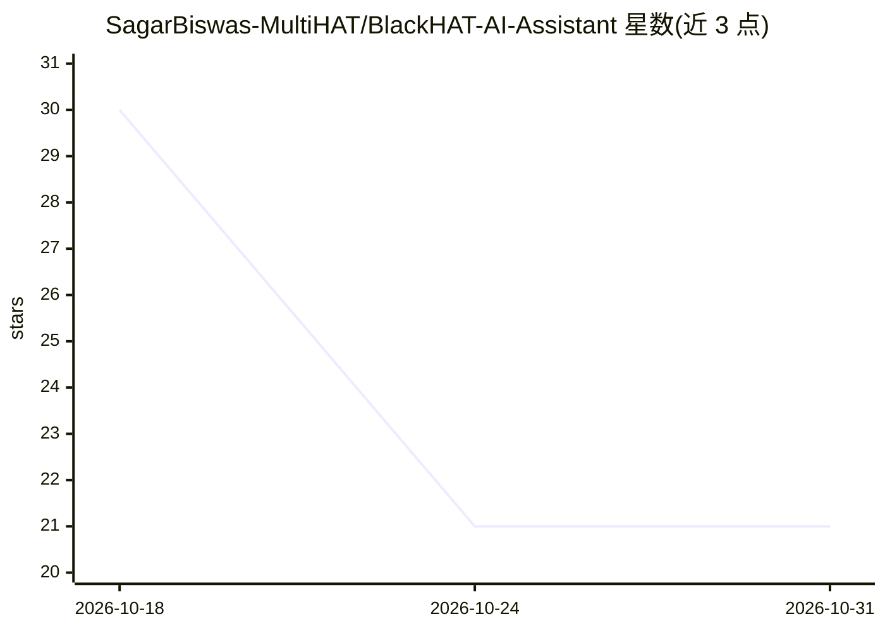

# SagarBiswas-MultiHAT/BlackHAT-AI-Assistant

⭐ 21 · Python · MIT · 推送 2026-02-13 · [GitHub](https://github.com/SagarBiswas-MultiHAT/BlackHAT-AI-Assistant) · 个人维护

**Tkinter 桌面 AI 助手：Groq 问答与快捷网页命令**

Python 编写的本地桌面工具，基于 Tkinter 构建 GUI。用户输入自然语言查询，通过 Groq API 获取 AI 回答；输入 'open google' 等命令可快捷打开 Google、YouTube、GitHub 等网站。会话历史在关闭时自动保存并可重载，实现离线的会话回溯。安装方式为克隆源码并 pip 安装依赖，需配置 GROQ_API_KEY 环境变量或 .env 文件，另需放置背景图片文件。可通过修改 url_map 字典扩展网站快捷命令。

## 筛选速览

| 维度 | 判定 | 备注 |
|---|---|---|
| AI 角色 | `ai-native` | 本体是模型或模型工具 |
| 许可风险 | `permissive` | MIT |
| 部署形态 | `library` | 以包/库形式分发 |
| 模型依赖 | locked-api |  |
| 硬件要求 | — | 无带数字的原话,不猜 |
| 安装摩擦 | `low` | 无编译、无系统依赖或容器化 |
| 成熟度 | — | 结构信号不足 |

## 能力要点

- 自然语言查询经 Groq API 获取 AI 回答
- 命令映射快捷打开 Google/YouTube/GitHub 等网站
- 会话历史自动保存与重载
- 通过 url_map 字典可扩展快捷命令

## 适用场景

- 在桌面上一站式进行 AI 问答与快捷打开常用网站
- 保存并回溯历史会话记录
- 按需扩展自定义的网站快捷命令

## 场景标签

`AI 助手` · 领域:对话与助手

## 证据(README 行号)

> L13: BlackHAT-AI-Assistant is a Python-based desktop tool designed to combine AI-powered features with an easy-to-use in
> L17: - **AI-Driven Commands:** Execute tasks and interact with Groq AI for assistance.

## 星数曲线

2026-10-18 30 → 2026-10-31 21（-9）

---
*卡片 v1 · prompt 1.4 · 生成 2026-10-28 · 置信度 mid · 依据 README sha `59d027fe0a7e` · [字段定义](../../DATASET.md)*
