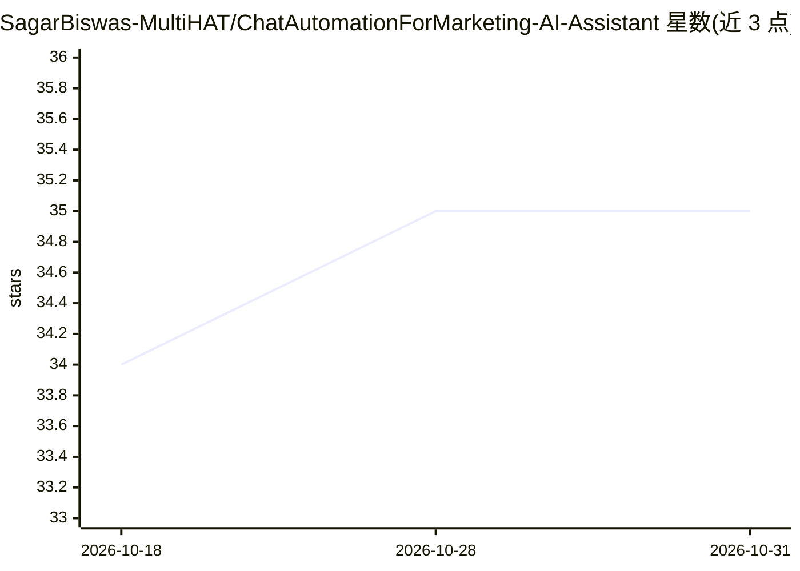

# SagarBiswas-MultiHAT/ChatAutomationForMarketing-AI-Assistant

⭐ 35 · Python · MIT · 推送 2026-08-31 · [GitHub](https://github.com/SagarBiswas-MultiHAT/ChatAutomationForMarketing-AI-Assistant) · [官网](https://www.facebook.com/share/v/1PCci8RnYD/) · 个人维护

**桌面自动化机器人：自动回复 Messenger/WhatsApp 消息**

基于 PyAutoGUI 屏幕自动化与 Pyperclip 剪贴板读取的聊天自动回复工具，覆盖 Messenger、WhatsApp 等聊天界面。按预设屏幕坐标循环点击多个会话，复制聊天文本、识别最后发言人，若为新消息则调用 Groq API 生成并发送回复；自己发送的消息不回复。提供 dry-run 模式、日志、坐标采集脚本与 config.json 配置。需 Python 3.7+ 与 Groq API key，依赖固定屏幕坐标。

## 筛选速览

| 维度 | 判定 | 备注 |
|---|---|---|
| AI 角色 | `ai-enhanced` | 去掉 AI 部分产品仍成立 |
| 许可风险 | `permissive` | MIT |
| 部署形态 | `library` | 以包/库形式分发 |
| 模型依赖 | locked-api |  |
| 硬件要求 | — | 无带数字的原话,不猜 |
| 安装摩擦 | `low` | 无编译、无系统依赖或容器化 |
| 成熟度 | — | 结构信号不足 |

## 能力要点

- PyAutoGUI 坐标点击 + 剪贴板读取实现跨平台聊天界面自动化
- Groq API 生成回复，模型可经 GROQ_MODEL 配置
- dry-run 模式不点击不发送，日志记录扫描与回复决策
- 跳过自己发送的消息，仅回复新收到的用户消息

## 适用场景

- 让机器人持续值守并自动回复多个 Messenger/WhatsApp 会话
- 先用 dry-run 模式测试回复逻辑再实际发送
- 配置人设后自动生成符合风格的聊天回复

## 场景标签

`GUI 自动化` · 领域:效率与自动化

## 证据(README 行号)

> L7: This project automates chat replies (e.g., Messenger, WhatsApp) using screen automation with PyAutoGUI, clipboard ha
> L21: - Sends AI-generated replies based on your configured persona.

## 星数曲线

2026-10-18 34 → 2026-10-31 35（+1）

---
*卡片 v1 · prompt 1.4 · 生成 2026-10-26 · 置信度 mid · 依据 README sha `4c3c4f19229c` · [字段定义](../../DATASET.md)*
