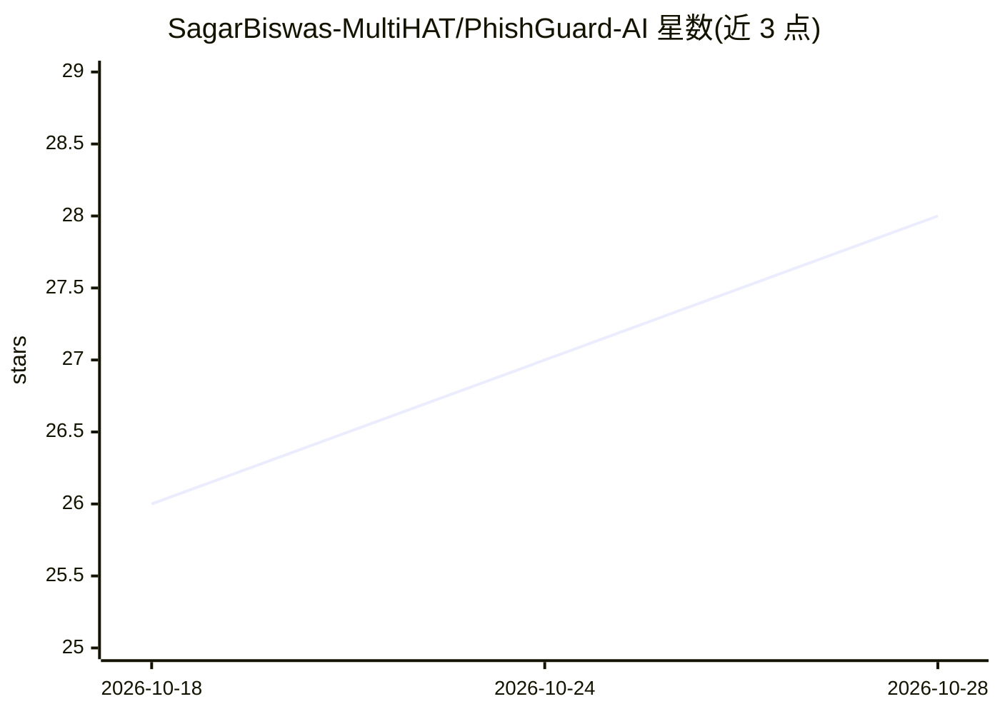

# SagarBiswas-MultiHAT/PhishGuard-AI

⭐ 28 · Python · MIT · 推送 2026-10-13 · [GitHub](https://github.com/SagarBiswas-MultiHAT/PhishGuard-AI) · [官网](https://phishguard.multihat.dev) · 个人维护

**识钓训练网页游戏：AI 生成并双重校验钓鱼邮件供玩家判断**

基于 Flask 的交互式网页游戏，面向普通用户训练识别钓鱼邮件的能力。每轮由 OpenRouter 上的模型实时生成唯一钓鱼/正常邮件，玩家需在 10 秒内判定真伪并获得即时反馈。核心机制为双 AI 共识引擎：生成模型写作、Groq 上独立模型盲评打分，双方分类一致且质量分≥3 才通过；OpenRouter 限流时触发 60 秒熔断并切换 Groq 生成。本地运行需 Python 3.11+ 及免费的 OpenRouter 与 Groq API key。

## 筛选速览

| 维度 | 判定 | 备注 |
|---|---|---|
| AI 角色 | `ai-native` | 本体是模型或模型工具 |
| 许可风险 | `permissive` | MIT |
| 部署形态 | `None` |  |
| 模型依赖 | locked-api |  |
| 硬件要求 | — | 无带数字的原话,不猜 |
| 安装摩擦 | `low` | 无编译、无系统依赖或容器化 |
| 成熟度 | — | 结构信号不足 |

## 能力要点

- 双 AI 共识引擎：一个模型生成邮件，另一个独立模型盲评校验
- 30+ 职场与消费场景威胁分类库（CEO 欺诈、OAuth 钓鱼、MFA 疲劳等）
- OpenRouter 限流熔断与 Groq 自动回退，维持不间断游戏
- 后台异步预取下一题，实时计分与作答追踪

## 适用场景

- 以限时游戏方式练习识别钓鱼邮件
- 企业安全意识培训中的互动练习工具
- 本地搭建后自测钓鱼辨识反应速度

## 场景标签

`网络安全` · 领域:学习与行业

## 证据(README 行号)

> L20: Instead of sitting through boring cybersecurity slideshows, PhishGuard throws you right into the deep end: you are 
> L32: * **Dual-AI Verification:** To make sure the game is always accurate, we use two separate AI models. One creates th
> L48: Getting PhishGuard running locally is simple. You need Python and free API keys from OpenRouter and Groq (no credit

## 星数曲线

2026-10-18 26 → 2026-10-28 28（+2）

---
*卡片 v1 · prompt 1.4 · 生成 2026-10-26 · 置信度 high · 依据 README sha `bdac0d8c594f` · [字段定义](../../DATASET.md)*
