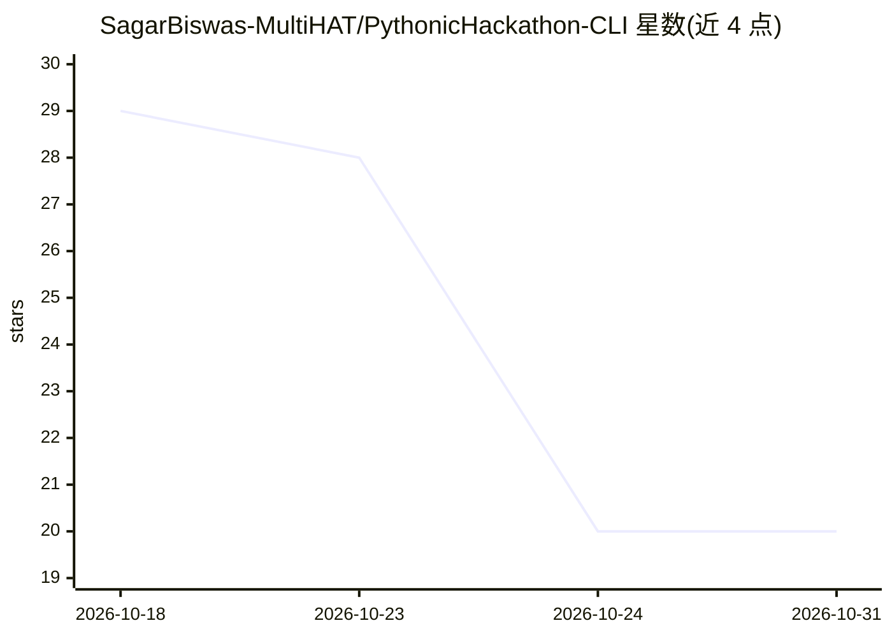

# SagarBiswas-MultiHAT/PythonicHackathon-CLI

⭐ 20 · Python · 推送 2026-02-13 · [GitHub](https://github.com/SagarBiswas-MultiHAT/PythonicHackathon-CLI) · [官网](https://www.facebook.com/share/v/16o1vigQZn/) · 个人维护

**面向 CSE 学生的命令行虚拟助手：开网站、放歌、AI 问答**

基于 Python 的终端虚拟助手 Sagar，提供单行与多行两种命令模式：将短语映射为 URL 打开可信网站（Google、GitHub、Stack Overflow 等）、播放词典中收录的歌曲链接，未命中内置规则的输入则通过 Groq API（默认 llama-3.3-70b-versatile）生成 AI 回答，会话内保留短期上下文。系统提示要求 AI 拒绝不安全请求并给出替代建议。支持 git clone 源码运行或 pip install -e . 安装 CLI 入口，需设置 GROQ_API_KEY，缺少时程序报错退出。可自定义 url_map、曲库与系统提示词。

## 筛选速览

| 维度 | 判定 | 备注 |
|---|---|---|
| AI 角色 | `ai-enhanced` | 去掉 AI 部分产品仍成立 |
| 许可风险 | `none` | — |
| 部署形态 | `library` | 以包/库形式分发 |
| 模型依赖 | locked-api |  |
| 硬件要求 | — | 无带数字的原话,不猜 |
| 安装摩擦 | `low` | 无编译、无系统依赖或容器化 |
| 成熟度 | — | 结构信号不足 |

## 能力要点

- 单行/多行两种命令模式，CLI 入口 sagar 与 sagar-multi
- 内置规则外的输入经 Groq API 生成 AI 回答，会话内保留上下文
- url_map 与曲库词典可自定义扩展
- 含 pytest 单元测试、ruff 检查与 CI 工作流

## 适用场景

- 在终端快速打开常用学习网站与播放曲目
- 向 AI 询问加密、密码安全等网络安全基础问题
- 作为 Python CLI 与 Groq API 集成的学习示例项目

## 场景标签

`AI 助手` · 领域:对话与助手

## 证据(README 行号)

> L10: Sagar is a friendly, command-line virtual assistant for CSE students and aspiring cybersecurity professionals. It u
> L163: If a command doesn’t match a built-in rule, Sagar sends it to the AI model and returns the response. It also keeps
> L23: - **Open websites** (e.g., Google, GitHub, Stack Overflow)

## 星数曲线

2026-10-18 29 → 2026-10-31 20（-9）

---
*卡片 v1 · prompt 1.4 · 生成 2026-10-28 · 置信度 high · 依据 README sha `d866c334c81c` · [字段定义](../../DATASET.md)*
