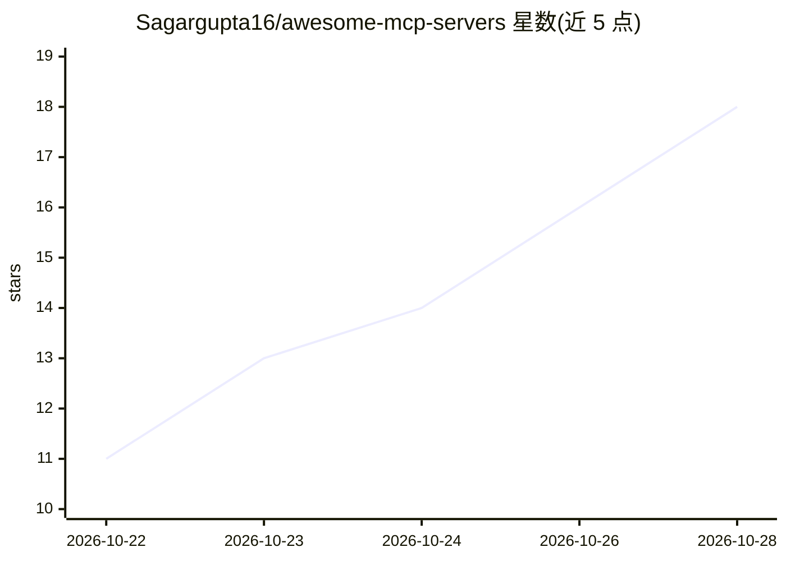

# Sagargupta16/awesome-mcp-servers

⭐ 24 · Python · CC0-1.0 · 推送 2026-10-28 · [GitHub](https://github.com/Sagargupta16/awesome-mcp-servers) · [官网](http://sagargupta.online/awesome-mcp-servers/) · 个人维护

**经人工核验的 MCP 服务器与工具策展清单（可搜索站点）**

由个人维护的 MCP（Model Context Protocol）服务器与工具策展清单：收录条目须真实实现 MCP、声明开源许可、180 天内有推送、含安装配置文档，并由 CI 强制校验格式与链接，每月复审。条目按数据与数据库、开发工具、云与基础设施、办公效率等类别组织，另收录官方规范、参考实现与测试工具。提供每小时从 README 重建的可搜索站点，支持分类与语言过滤。面向为 AI 客户端挑选 MCP 服务器的开发者。

## 筛选速览

| 维度 | 判定 | 备注 |
|---|---|---|
| AI 角色 | `ai-knowledge` | 知识聚合/清单类 |
| 许可风险 | `viral` | CC0-1.0 |
| 部署形态 | `None` |  |
| 模型依赖 | — | README 未给出锁定关系 |
| 硬件要求 | — | 无带数字的原话,不猜 |
| 安装摩擦 | `high` | 编译与系统依赖俱全 |
| 成熟度 | — | 结构信号不足 |

## 能力要点

- 每条目经核验：真实实现 MCP、开源许可、180 天内活跃、含安装文档
- CI 强制校验提交格式与死链，每月复审已收录仓库
- 按数据/开发工具/云基础设施/办公效率等类别组织
- 配套每小时重建的可搜索站点（搜索/分类/语言过滤/live stars）

## 适用场景

- 为 Claude、Cursor 等 AI 客户端查找可用的 MCP 服务器
- 按类别筛选特定语言或领域的 MCP 工具
- 查阅 MCP 官方规范、参考实现与测试工具入口

## 场景标签

`精选清单` · 领域:学习与行业

## 证据(README 行号)

> L3: > Model Context Protocol (MCP) is an open protocol that lets AI applications such as Claude, ChatGPT, Cursor and Win
> L7: **This list is curated, not exhaustive, and open to anyone.** Bigger MCP lists exist. The point of this one is that 

## 星数曲线

2026-10-22 11 → 2026-10-28 18（+7）

---
*卡片 v1 · prompt 1.4 · 生成 2026-10-28 · 置信度 high · 依据 README sha `1cb0c0c22212` · [字段定义](../../DATASET.md)*
