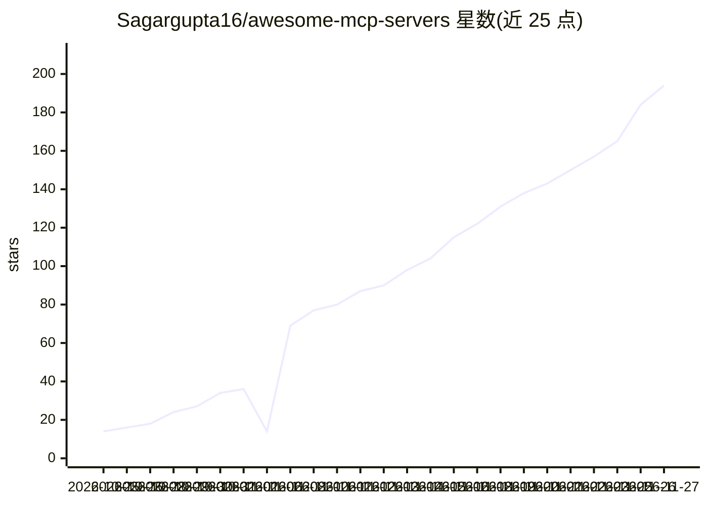

# Sagargupta16/awesome-mcp-servers

⭐ 194 · Python · CC0-1.0 · 推送 2026-11-26 · [GitHub](https://github.com/Sagargupta16/awesome-mcp-servers) · [官网](http://sagargupta.online/awesome-mcp-servers/) · 个人维护

**经 CI 校验的 MCP 服务器与工具精选清单**

Model Context Protocol 服务器、工具、框架与资源的策展清单，按数据与数据库、开发者工具、云与基础设施等分类组织，每条标注实现语言与是否为 Remote 托管。收录规则由 CI 强制执行：真实实现 MCP、声明开源许可、180 天内有提交、可安装可配置、每个条目仅归一类；每月自动复审并移除失效项。还提供每小时从 README 重建的可搜索站点，支持分类与语言过滤。

## 筛选速览

| 维度 | 判定 | 备注 |
|---|---|---|
| AI 角色 | `ai-knowledge` | 知识聚合/清单类 |
| 许可风险 | `viral` | CC0-1.0 |
| 部署形态 | `None` |  |
| 模型依赖 | — | README 未给出锁定关系 |
| 硬件要求 | — | 无带数字的原话,不猜 |
| 安装摩擦 | `medium` | 含编译或系统依赖之一 |
| 成熟度 | — | 结构信号不足 |

## 能力要点

- 收录规则由 CI 自动校验，含月度失效复审
- Remote 条目需 CI 检查端点可用性
- 每小时重建的可搜索站点（搜索、分类、语言过滤、实时 star 数）
- 条目不设最低 star 数，欢迎自荐提交

## 适用场景

- 为 Claude、Cursor 等 AI 客户端查找可接入的 MCP 服务器
- 查找特定数据库或开发工具的 MCP 集成
- 提交自己的 MCP 项目进入策展清单

## 场景标签

`精选清单` · 领域:学习与行业

## 证据(README 行号)

> L1: # Awesome MCP Servers Awesome
> L7: **This list is curated, not exhaustive, and open to anyone.** Bigger MCP lists exist. The point of this one is that 
> L17: Those rules are enforced by CI, not by good intentions: a pull request that breaks the format, adds a dead link, or

## 星数曲线

2026-10-25 14 → 2026-11-27 194（+180）

---
*卡片 v1 · prompt 1.4 · 生成 2026-11-27 · 置信度 high · 依据 README sha `605e08840972` · [字段定义](../../DATASET.md)*
