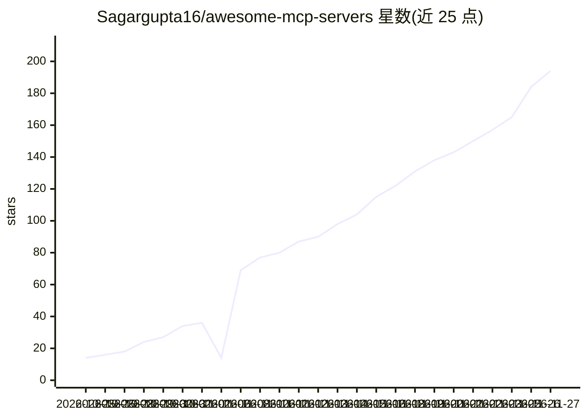

# Sagargupta16/awesome-mcp-servers

⭐ 194 · Python · CC0-1.0 · 推送 2026-11-26 · [GitHub](https://github.com/Sagargupta16/awesome-mcp-servers) · [官网](http://sagargupta.online/awesome-mcp-servers/) · 个人维护

**MCP 服务器与工具的策展清单，供 AI 应用接入方查找**

一份经 CI 校验的 MCP（Model Context Protocol）服务器、工具、框架与资源策展清单。收录规则明确：真实实现 MCP、声明开源许可、180 天内有推送、未归档、有安装配置文档、每条目只归一类；无公开源的托管服务例外标记 Remote。每月复审清理失效条目，格式错误或死链的 PR 会被 CI 拒绝。另提供从该 README 每小时重建的可搜索站点，支持分类与语言过滤。

## 筛选速览

| 维度 | 判定 | 备注 |
|---|---|---|
| AI 角色 | `ai-knowledge` | 知识聚合/清单类 |
| 许可风险 | `viral` | CC0-1.0 |
| 部署形态 | `None` |  |
| 模型依赖 | — | README 未给出锁定关系 |
| 硬件要求 | — | 无带数字的原话,不猜 |
| 安装摩擦 | `medium` | 含编译或系统依赖之一 |
| 成熟度 | — | 结构信号不足 |

## 能力要点

- CI 强制校验收录规则（格式、死链、许可），每月复审全量条目
- 按数据库、开发者工具、云基础设施等类别组织的 MCP 服务器表格
- 可搜索站点每小时从 README 重建，带分类与语言过滤
- 标注每条目实现语言与官方/社区属性

## 适用场景

- 为 Claude、Cursor 等 AI 应用查找可接入的 MCP 服务器
- 提交自己的 MCP 服务器进入策展列表
- 按类别浏览官方参考实现与社区服务器

## 场景标签

`精选清单` · 领域:学习与行业

## 证据(README 行号)

> L1: # Awesome MCP Servers Awesome
> L7: **This list is curated, not exhaustive, and open to anyone.** Bigger MCP lists exist. The point of this one is that 
> L9: - implements MCP for real -- not a README with a `server.json` next to it

## 星数曲线

2026-10-25 14 → 2026-11-27 194（+180）

---
*卡片 v1 · prompt 1.4 · 生成 2026-11-26 · 置信度 high · 依据 README sha `b60d17964d9b` · [字段定义](../../DATASET.md)*
