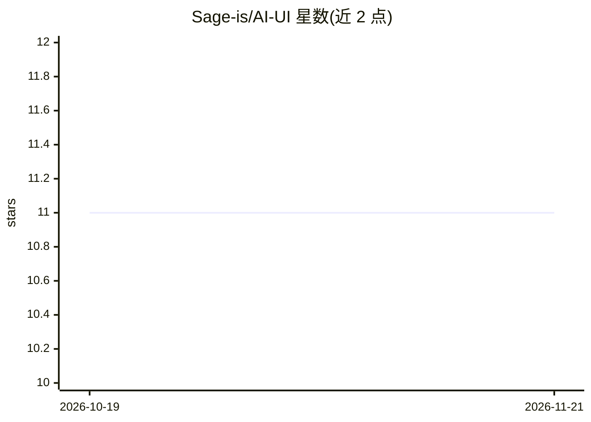

# Sage-is/AI-UI

⭐ 11 · Python · AGPL-3.0 · 推送 2026-11-16 · [GitHub](https://github.com/Sage-is/AI-UI) · [官网](https://sage.is) · 组织维护

**自托管的多模型聊天与编排界面：私有运行自己的 AI**

运行在自有基础设施上的聊天与编排层：接入任意 OpenAI 兼容服务商及 Ollama，提供多模型同会话切换、RAG 知识库（PDF/文档/网页）、角色权限与用户组、隐私化外发文本的隐私规则（默认开启）、WhatsApp/Telegram/Signal/邮件消息桥接、内置 Python 代码执行、语音与图像生成。通过 Homebrew 安装或源码运行，macOS 上经 Colima 无窗口运行，可配置端口与环境变量。

## 筛选速览

| 维度 | 判定 | 备注 |
|---|---|---|
| AI 角色 | `ai-ecosystem` | LLM/agent 周边工具 |
| 许可风险 | `viral` | AGPL-3.0 |
| 部署形态 | `None` |  |
| 模型依赖 | local-ok | 支持本地模型 |
| 硬件要求 | — | 无带数字的原话,不猜 |
| 安装摩擦 | `low` | 无编译、无系统依赖或容器化 |
| 成熟度 | — | 结构信号不足 |

## 能力要点

- 接入任意 OpenAI 兼容服务商与 Ollama，可按会话混合服务商
- RAG 知识库：从 PDF、文档、网站构建检索增强聊天
- 隐私规则：发往托管模型的文本假名化并在回复时还原
- 消息桥接 WhatsApp/Telegram/Signal/邮件，支持 SSO/LDAP 审计日志

## 适用场景

- 小团队或学校在自有服务器上私有部署 AI 聊天与知识库
- 在同一界面使用和切换多个模型服务商
- 通过 WhatsApp/Telegram 等渠道接入对话
- 需要对外发内容做隐私化处理后再使用托管模型

## 场景标签

`聊天机器人` `RAG` · 领域:对话与助手

## 证据(README 行号)

> L11: Sage.is AI-UI is a chat and orchestration layer you run on your own infrastructure. It talks to any OpenAI-compatib
> L46: - **Teams work the way teams work.** Permissions, user groups, role-based access. Nothing exotic, nothing missing.
> L52: - **Knowledge bases:** RAG-powered chats from PDFs, docs, websites, or Workshop Knowledge.

## 星数曲线

2026-10-19 11 → 2026-11-21 11（+0）

---
*卡片 v1 · prompt 1.4 · 生成 2026-11-18 · 置信度 high · 依据 README sha `06f4baab60a2` · [字段定义](../../DATASET.md)*
