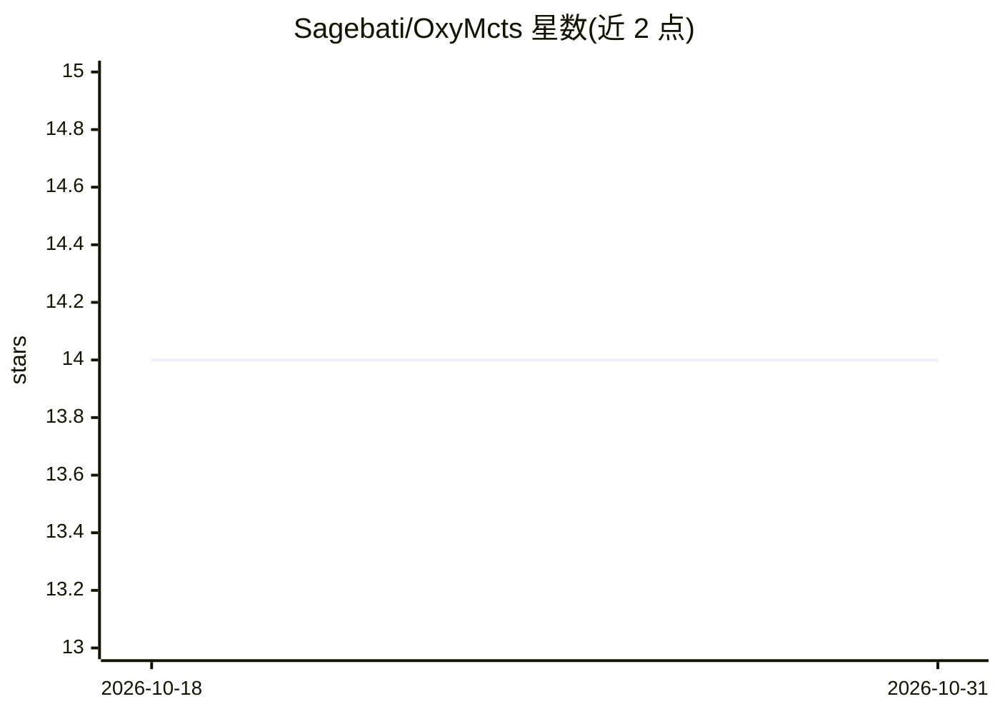

# Sagebati/OxyMcts

⭐ 14 · Rust · MIT · 推送 2026-03-24 · [GitHub](https://github.com/Sagebati/OxyMcts) · 个人维护

**Rust 编写的通用蒙特卡洛树搜索库，可自定义各组件**

面向 Rust 开发者的蒙特卡洛树搜索（MCTS）库。将 MCTS 拆分为树策略（选择、扩展）、模拟、反向传播四个操作，各操作以 trait 形式提供、可互换实现，用户可实现自己的树策略而不修改库代码。节点不存储游戏状态，仅存储到达该状态的走子历史。内置 UCT 与朴素模拟，自带井字棋示例（examples/tictactoe）。README 自述测试与性能分析较少，尚未实现并行化与哈希表版本。

## 筛选速览

| 维度 | 判定 | 备注 |
|---|---|---|
| AI 角色 | `ai-native` | 本体是模型或模型工具 |
| 许可风险 | `permissive` | MIT |
| 部署形态 | `None` |  |
| 模型依赖 | — | README 未给出锁定关系 |
| 硬件要求 | — | 无带数字的原话,不猜 |
| 安装摩擦 | `low` | 无编译、无系统依赖或容器化 |
| 成熟度 | `idea` | |

## 能力要点

- 对游戏与实现均通用的 MCTS 库，组件可互换
- 节点仅存走子历史而非完整状态，减少内存占用
- 内置 UCT 方法与朴素模拟，开箱可用
- 附井字棋示例与对比随机 bot 的实验数据

## 适用场景

- 为自研棋类/博弈游戏接入 MCTS 决策
- 替换或实验不同的选择、模拟策略
- 学习 MCTS 各阶段可插拔的实现结构

## 场景标签

 · 领域:算法库/强化学习

## 证据(README 行号)

> L10: Library to play with an monte carlo tree search, it's generic over the game. see `examples/tictactoe`.
> L12: This lib is also generic over the implementation and modular. indeed a normal MCTS can be divided in four operation

## 星数曲线

2026-10-18 14 → 2026-10-31 14（+0）

---
*卡片 v1 · prompt 1.4 · 生成 2026-10-31 · 置信度 mid · 依据 README sha `4b46cfb83267` · [字段定义](../../DATASET.md)*
