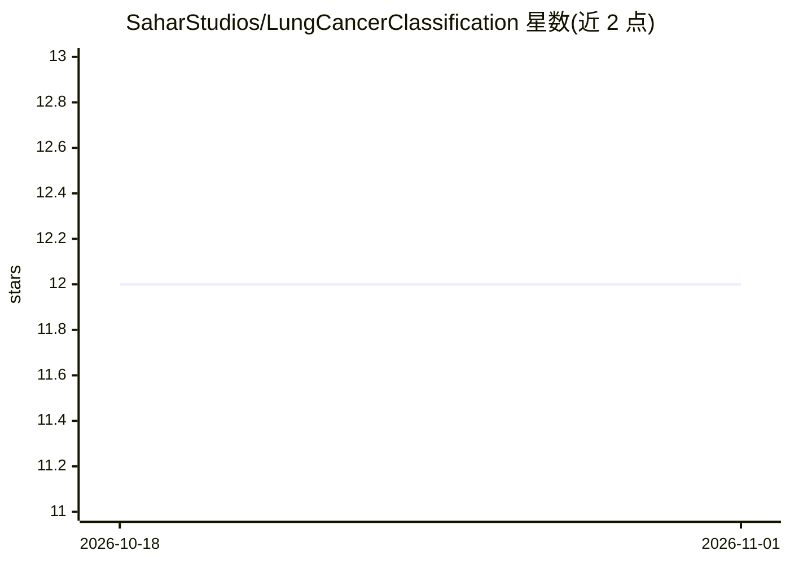

# SaharStudios/LungCancerClassification

⭐ 12 · Jupyter Notebook · MIT · 推送 2026-10-14 · [GitHub](https://github.com/SaharStudios/LungCancerClassification) · 个人维护

**基于 CNN 的肺癌类型预测系统，上传医学图像获取预测**

利用训练好的卷积神经网络（CNN）对肺癌组织病理图像进行类型分类，通过 Streamlit 部署为网页应用：用户上传医学图像后获得各癌症类型的概率分布，以饼图形式展示。面向医疗专业人员与研究人员使用。README 未给出具体的安装运行命令、模型细节或数据集（LIDC）说明，仅描述系统组成与贡献方式。

## 筛选速览

| 维度 | 判定 | 备注 |
|---|---|---|
| AI 角色 | `ai-native` | 本体是模型或模型工具 |
| 许可风险 | `permissive` | MIT |
| 部署形态 | `None` |  |
| 模型依赖 | — | README 未给出锁定关系 |
| 硬件要求 | — | 无带数字的原话,不猜 |
| 安装摩擦 | `low` | 无编译、无系统依赖或容器化 |
| 成熟度 | — | 结构信号不足 |

## 能力要点

- CNN 模型对肺癌组织病理图像做类型分类
- Streamlit 网页界面：上传图像、接收预测
- 预测结果以概率分布饼图展示

## 适用场景

- 上传肺部医学图像查看各癌症类型的预测概率
- 辅助医疗专业人员进行肺癌类型分析的参考工具

## 场景标签

`目标检测` · 领域:感知与多模态

## 证据(README 行号)

> L3: Welcome to the Lung Cancer Classification repository. This project focuses on utilizing deep learning techniques to 
> L19: In the realm of medical imaging and cancer diagnosis, the ability to accurately classify lung cancer types is cruci

## 星数曲线

2026-10-18 12 → 2026-11-01 12（+0）

---
*卡片 v1 · prompt 1.4 · 生成 2026-11-01 · 置信度 high · 依据 README sha `ceb244871ee0` · [字段定义](../../DATASET.md)*
