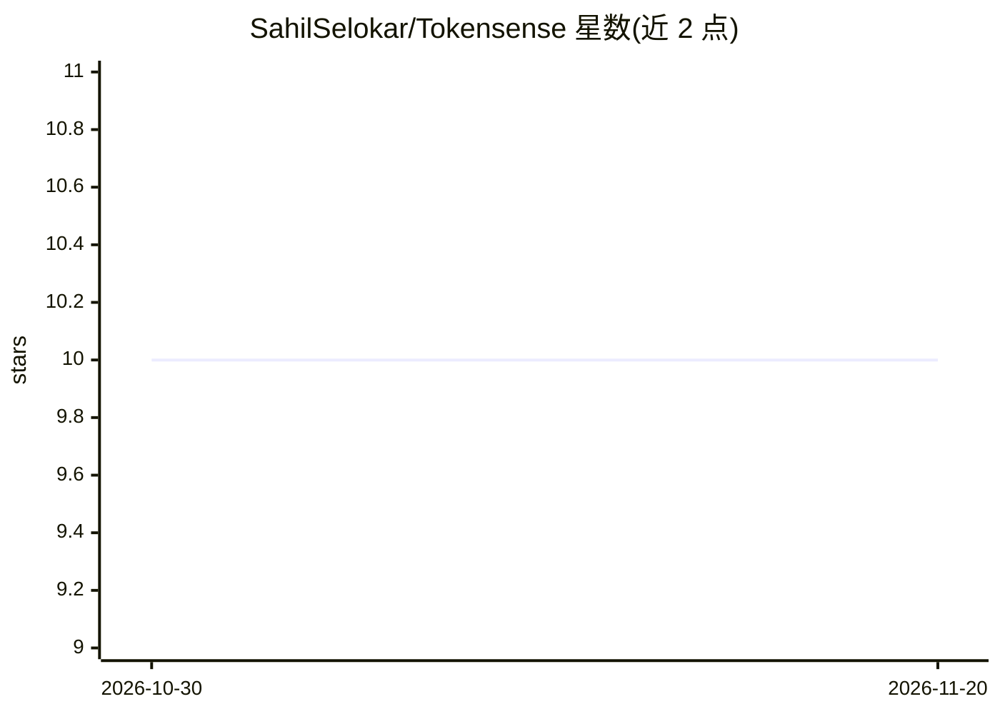

# SahilSelokar/Tokensense

⭐ 10 · Python · MIT · 推送 2026-06-23 · [GitHub](https://github.com/SahilSelokar/Tokensense) · [官网](https://visualvortexcreatives.dev) · 组织维护

**进程内 LLM 成本观测与智能路由库，无需代理**

以 pip 安装的 Python 库，通过一个 observe 包装器跟踪应用内每次 LLM 调用的模型、token 数、成本、延迟与路由决策，默认只记录元数据不记录提示词内容。提供基于上下文预算的模型路由与失败自动升级、ShadowTest 多模型并行评分、基于 sqlite-vec 的语义缓存，以及 LangChain/LlamaIndex 回调集成。数据输出到终端、SQLite、logger、HTTP 端点或 OTEL。需 Python 3.10+。

## 筛选速览

| 维度 | 判定 | 备注 |
|---|---|---|
| AI 角色 | `ai-ecosystem` | LLM/agent 周边工具 |
| 许可风险 | `permissive` | MIT |
| 部署形态 | `library` | 以包/库形式分发 |
| 模型依赖 | locked-api |  |
| 硬件要求 | — | 无带数字的原话,不猜 |
| 安装摩擦 | `low` | 无编译、无系统依赖或容器化 |
| 成熟度 | — | 结构信号不足 |

## 能力要点

- 进程内运行，无代理、无遥测，观察器在响应返回后触发
- Smart routing：上下文预算感知的模型切换与失败自动升级
- ShadowTest 用真实提示词并行测试多个模型并打分
- SQLite 本地语义缓存拦截重复请求

## 适用场景

- 统计应用中每次 LLM 调用的 token 用量与美元成本
- 按提示词长度预算自动选择模型并控制支出
- 上线前用真实提示词对比更便宜模型的效果
- 将调用追踪导出到 Datadog/Grafana/Jaeger

## 场景标签

`模型网关` `LLM 可观测性` · 领域:Agent 开发

## 证据(README 行号)

> L7: **LLM cost observability and smart routing — stays in your code, works everywhere.**
> L145: TokenSense has native integrations with LangChain and LlamaIndex via callback handlers. You do not need to use `ob

## 星数曲线

2026-10-30 10 → 2026-11-20 10（+0）

---
*卡片 v1 · prompt 1.4 · 生成 2026-11-20 · 置信度 high · 依据 README sha `005fdaf361db` · [字段定义](../../DATASET.md)*
