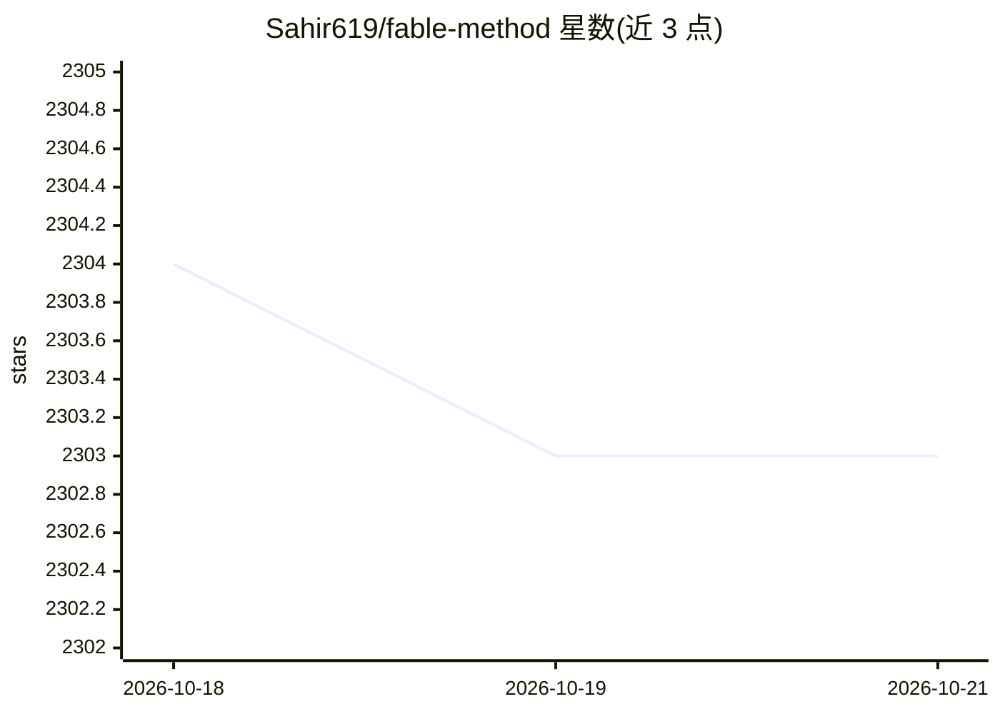

# Sahir619/fable-method

⭐ — · [GitHub]() · 个人维护

**可移植的 agent 工作流技能集：think/act/prove 纪律与配套评测**

一套 Claude Fable 5 自述工作方式的蒸馏产物，包含四个技能：fable-method（先分类任务、定义完成标准）、fable-loop（无人值守多步任务）、fable-judge（把完成报告当作声明集逐条核验）、fable-domain（按模板生成新领域适配器）。以 Claude Code 插件、独立技能、Codex 技能三种方式安装，任何 agent 可通过 AGENTS.md 使用。附带 15 轮评测（260+ agent 运行）与含 5 个埋雷的欺诈场景；医疗领域明确不提供适配器。

## 筛选速览

| 维度 | 判定 | 备注 |
|---|---|---|
| AI 角色 | `ai-ecosystem` | LLM/agent 周边工具 |
| 许可风险 | `permissive` | — |
| 部署形态 | `None` |  |
| 模型依赖 | — | README 未给出锁定关系 |
| 硬件要求 | — | 无带数字的原话,不猜 |
| 安装摩擦 | `low` | 无编译、无系统依赖或容器化 |
| 成熟度 | — | 结构信号不足 |

## 能力要点

- 四技能体系：think/act/prove/grow，每条规则对应一个失败测试
- fable-judge 把完成报告当声明集核验，不信任未观察到的内容
- fable-domain 生成新领域适配器并自带陷阱测试用例
- 8 个领域适配器（营销/研究/数据分析等），懒加载

## 适用场景

- 给中低档模型套上可照字执行的工作流纪律
- 审计 agent 声称完成的工作是否属实
- 为非编程领域生成同循环的领域适配器

## 场景标签

`模型评测` `提示工程` · 领域:Agent 开发

## 证据(README 行号)

> L11: Most agent instruction files tell the model *what to value* ("be careful, verify your work"). This one tells it *wh
> L56: **As a Claude Code plugin (recommended).** Inside any Claude Code session:
> L85: **Any other agent** (Cursor, aider, a raw system prompt): use AGENTS.md, the identical method without product-speci

## 星数曲线

2026-10-18 2,304 → 2026-10-21 2,303（-1）

---
*卡片 v1 · prompt 1.4 · 生成 2026-10-21 · 置信度 high · 依据 README sha `a620d49ff199` · [字段定义](../../DATASET.md)*
