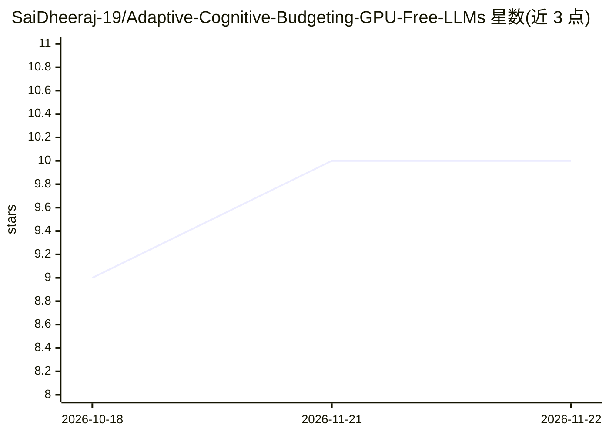

# SaiDheeraj-19/Adaptive-Cognitive-Budgeting-GPU-Free-LLMs

⭐ 10 · Python · MIT · 推送 2026-10-02 · [GitHub](https://github.com/SaiDheeraj-19/Adaptive-Cognitive-Budgeting-GPU-Free-LLMs) · 个人维护

**为无 GPU 内存受限电脑的本地 LLM 推理动态分配上下文与 CPU 资源**

ACB 是叠加在未修改的 llama.cpp server 之上的轻量控制层：每次查询前用启发式评分估计查询复杂度，读取 psutil 内存遥测与 EWMA 趋势，据此选择预算向量（量化精度、上下文窗口、生成长度、KV-cache 策略、CPU 线程数）；内存压力激增时触发重新协商钩子提前终止。面向在 8GB 内存无 GPU 笔记本上运行本地 LLM 的用户。README 附测量结果、数据集 schema 与复现脚本，并明确声明结果为单一 Apple M2 硬件上的单次试验，不推广到其他设备。

## 筛选速览

| 维度 | 判定 | 备注 |
|---|---|---|
| AI 角色 | `ai-ecosystem` | LLM/agent 周边工具 |
| 许可风险 | `permissive` | MIT |
| 部署形态 | `None` |  |
| 模型依赖 | — | README 未给出锁定关系 |
| 硬件要求 | `cpu-ok` | |
| 安装摩擦 | `low` | 无编译、无系统依赖或容器化 |
| 成熟度 | — | 结构信号不足 |

## 能力要点

- 每次查询前按复杂度启发式与内存遥测动态选择 5 维预算向量
- 内存压力激增时的重新协商钩子触发提前停止，避免换页导致进程被杀
- 提供完整数据集 schema（含 memory_pressure、swap 等字段）与论文引用
- 以 MIT 许可发布，附 Apple M2 8GB 单机试验测量结果

## 适用场景

- 在 8GB 内存无 GPU 笔记本上运行本地 LLM 并避免长时间换页停顿
- 复现或扩展该单机 CPU 推理资源调度实验

## 场景标签

`推理引擎` · 领域:训练与推理

## 证据(README 行号)

> L32: ACB is a lightweight control layer that sits **above** an unmodified llama.cpp server. Before each query, it answer
> L163: |Inference engine|llama.cpp b3799|

## 星数曲线

2026-10-18 9 → 2026-11-22 10（+1）

---
*卡片 v1 · prompt 1.4 · 生成 2026-11-21 · 置信度 high · 依据 README sha `f1ba4b741a29` · [字段定义](../../DATASET.md)*
