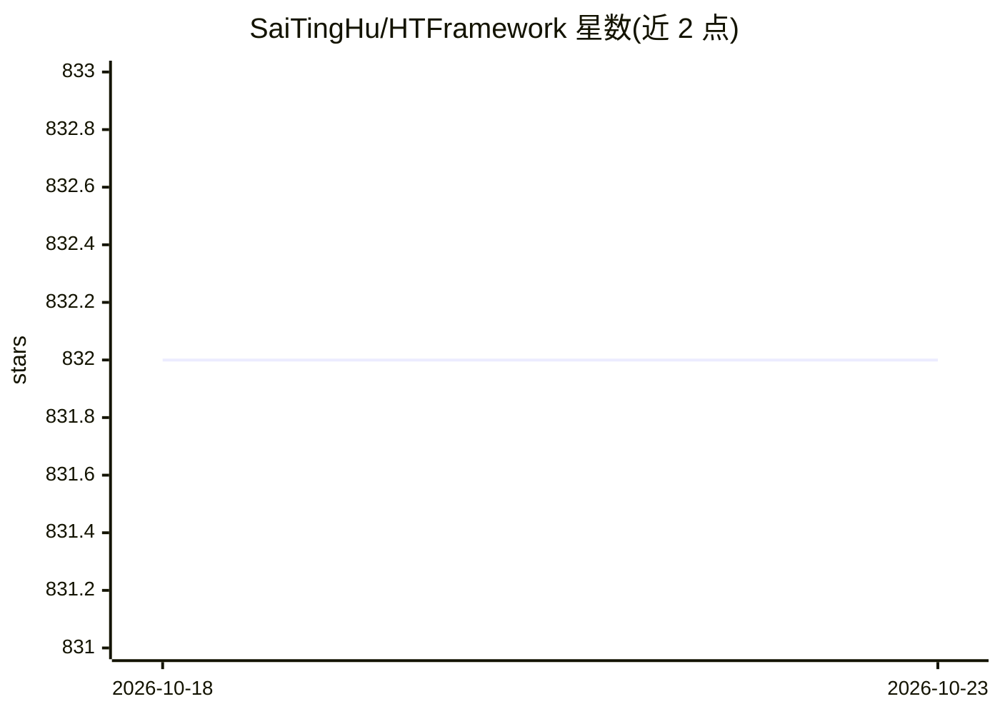

# SaiTingHu/HTFramework

⭐ 832 · C# · MIT · 推送 2026-10-12 · [GitHub](https://github.com/SaiTingHu/HTFramework) · 个人维护 · 中文 README

**基于 Unity 的客户端快速开发框架，模块化游戏功能套件**

面向 Unity 客户端开发的 C# 框架，提供二十余个内置模块：流程（Procedure）、实体/FSM、ECS、AOP 代码追踪、热更新（C# 反射，另支持 HybridCLR）、资源管理（Resource/AssetBundle/Addressables）、网络、UI、调试器、任务与步骤编辑器等，另有 AI（A* 寻路等）、资源部署管线、游戏组件等可选模块。要求 Unity 2022.3.34 与 .NET Framework，拉取源码到 Assets 目录使用，附多个游戏实战教程。

## 筛选速览

| 维度 | 判定 | 备注 |
|---|---|---|
| AI 角色 | `ai-enhanced` | 去掉 AI 部分产品仍成立 |
| 许可风险 | `permissive` | MIT |
| 部署形态 | `None` |  |
| 模型依赖 | — | README 未给出锁定关系 |
| 硬件要求 | — | 无带数字的原话,不猜 |
| 安装摩擦 | `low` | 无编译、无系统依赖或容器化 |
| 成熟度 | — | 结构信号不足 |

## 能力要点

- Procedure 流程为核心的全模块化架构，自定义模块与内置模块生命周期一致
- C# 反射实现的热更新模块，支持热更新库内动态修复方法
- 资源管理支持 Resource/AssetBundle/Addressables 三种加载模式
- 内置 Debugger 运行时调试器与大量编辑器/运行时工具

## 适用场景

- 用 Unity 快速搭建模块化的游戏客户端项目
- 在项目中实现 C# 热更新与运行时指令修补
- 跟随实战教程学习坦克大战、RPG、MMORPG 等类型开发

## 场景标签

 · 领域:游戏开发/客户端框架

## 证据(README 行号)

> L9: HTFramework是基于Unity的一个快速开发框架，集需求模块化、代码重用性、实用便捷性、功能高内聚、统一编码规范、可扩展性、可维护性、可通用性、可插拨性为一体，并提供持续维护、升级。
> L91: - AI【可选模块】 - AI相关模块，比如A*寻路以及各种人工智能模块。

## 星数曲线

2026-10-18 832 → 2026-10-23 832（+0）

---
*卡片 v1 · prompt 1.4 · 生成 2026-10-21 · 置信度 mid · 依据 README sha `f3456f85a590` · [字段定义](../../DATASET.md)*
