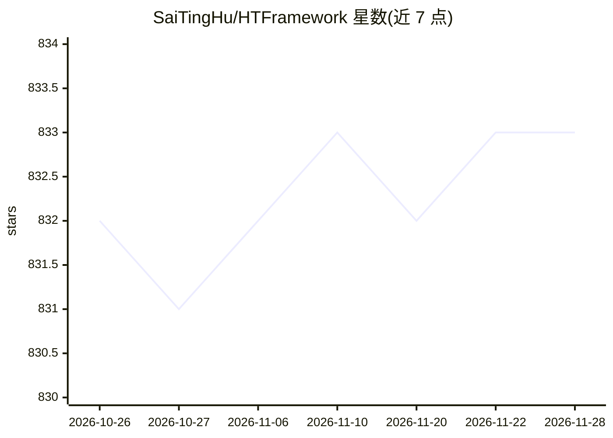

# SaiTingHu/HTFramework

⭐ 833 · C# · MIT · 推送 2026-11-25 · [GitHub](https://github.com/SaiTingHu/HTFramework) · 个人维护 · 中文 README

**Unity 客户端快速开发框架：模块化游戏开发与热更新**

基于 Unity 2022.3.34 的 C# 客户端开发框架，内置 20 余个模块：流程管理、ECS、FSM、实体管理、事件系统、对象池、资源加载（Resource/AssetBundle/Addressables）、TCP/UDP 网络管道、UI 管理、热更新（C# 反射实现）等，另有 AI 寻路、资源部署、游戏组件三个可选模块。通过拉取源码到 Assets 目录或添加子模块方式引入，配套游戏实战教程与博客文档。

## 筛选速览

| 维度 | 判定 | 备注 |
|---|---|---|
| AI 角色 | `ai-enhanced` | 去掉 AI 部分产品仍成立 |
| 许可风险 | `permissive` | MIT |
| 部署形态 | `None` |  |
| 模型依赖 | — | README 未给出锁定关系 |
| 硬件要求 | — | 无带数字的原话,不猜 |
| 安装摩擦 | `low` | 无编译、无系统依赖或容器化 |
| 成熟度 | — | 结构信号不足 |

## 能力要点

- 20+ 内置模块覆盖流程、ECS、FSM、事件、对象池、UI、网络等
- C# 反射实现的轻量级热更新，无需重新发布项目
- 资源加载支持 Resource/AssetBundle/Addressables 三种模式
- AI、Deployment、GameComponent 三个可插拔可选模块

## 适用场景

- 用统一框架组织 Unity 游戏项目的模块化开发
- 需要热更新或运行时修补程序功能的客户端项目
- 按实战教程学习 MMORPG、帧同步联机等游戏开发

## 场景标签

 · 领域:游戏开发框架

## 证据(README 行号)

> L9: HTFramework是基于Unity的一个快速开发框架，集需求模块化、代码重用性、实用便捷性、功能高内聚、统一编码规范、可扩展性、可维护性、可通用性、可插拨性为一体，并提供持续维护、升级。
> L91: - AI【可选模块】 - AI相关模块，比如A*寻路以及各种人工智能模块。
> L173: - 1.拉取框架到项目中的Assets文件夹下（Assets/HTFramework/），或以添加子模块的形式。

## 星数曲线

2026-10-26 832 → 2026-11-28 833（+1）

---
*卡片 v1 · prompt 1.4 · 生成 2026-11-26 · 置信度 high · 依据 README sha `8370ae4a35b6` · [字段定义](../../DATASET.md)*
