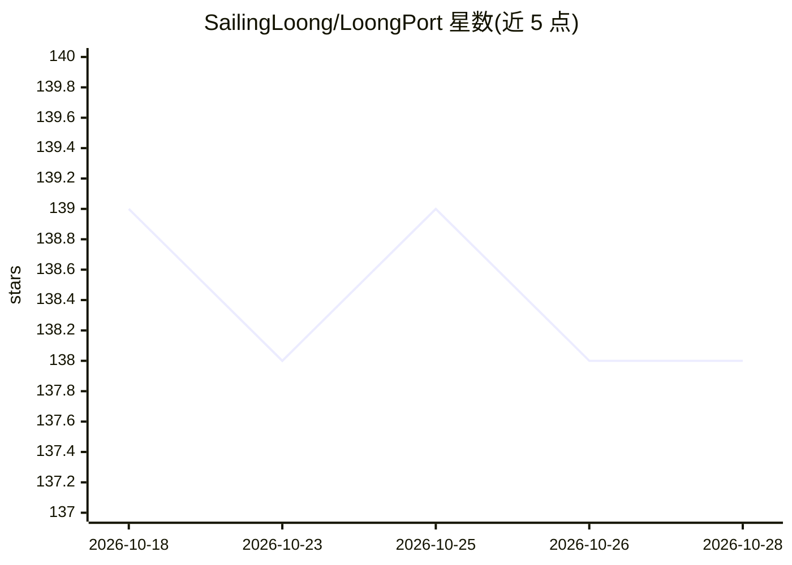

# SailingLoong/LoongPort

⭐ 138 · Rust · MIT · 推送 2026-10-27 · [GitHub](https://github.com/SailingLoong/LoongPort) · [官网](https://loongport.dev) · 个人维护 · 中文 README

**中转站专用的 AI CLI 配置客户端：填域名登录即用 Codex/Claude Code**

基于 cc-switch fork 的 Tauri 桌面应用，面向使用 API 中转站（sub2api/new-api）运行 Codex CLI 与 Claude Code 的用户：填入站点域名并在该站点登录后，自动为各档位备好密钥并按各 CLI 的配置形状写入文件，换档位只需一次点击。另含官网直连档位（DeepSeek、智谱 BigModel、opencode）、自动故障切换、模型指纹核验、本地用量统计与扣费对账、CLI 内生图（MCP server）。凭据在本机加密存储，无账号体系、无服务端。提供 Windows/macOS/Linux 桌面包与无 UI 的 loongport-cli。

## 筛选速览

| 维度 | 判定 | 备注 |
|---|---|---|
| AI 角色 | `ai-ecosystem` | LLM/agent 周边工具 |
| 许可风险 | `permissive` | MIT |
| 部署形态 | `desktop` | 安装包/桌面程序 |
| 模型依赖 | locked-api |  |
| 硬件要求 | — | 无带数字的原话,不猜 |
| 安装摩擦 | `low` | 无编译、无系统依赖或容器化 |
| 成熟度 | — | 结构信号不足 |

## 能力要点

- 填域名+登录两步完成中转站接入，无需手动创建密钥或改配置文件
- 自动故障切换：按已应用优先级尝试备用档位
- 模型验证两层：主动逐项探测 + 本地路由被动比对模型指纹
- 凭据本机加密（系统凭据库解锁），本地路由仅监听 127.0.0.1

## 适用场景

- 我在中转站跑 Codex/Claude Code，想免去手动配密钥和 base_url
- 我想一键切换不同档位并自动故障切换
- 我想核对中转站扣费是否与实际用量一致

## 场景标签

`模型网关` · 领域:Agent 开发

## 证据(README 行号)

> L27: LoongPort 将其压缩为两步 —— **填入一个域名，登录一次。** 应用会为账号可用的每个档位备好密钥，按各 CLI 的配置形状完成写入；此后更换档位只需一次点击，配置文件从头到尾不用你碰。
> L49: 把 LoongPort 当作**你自己站点的客户端**发给新用户 —— 注册、充值、拿密钥都发生在你的站点上，新用户从下载到能用只剩「填域名、登录」两步。它是通用的 sub2api / new-api 客户端，不绑定任何一家站点：
> L209: cc-switch 是通用的多供应商管理器，管理所有 CLI 的所有供应商，还提供本地代理、MCP、Skills、Prompts 与会话管理。LoongPort 只做「用中转服务省心运行 AI CLI」这一条链路。两者数据目录分

## 星数曲线

2026-10-18 139 → 2026-10-28 138（-1）

---
*卡片 v1 · prompt 1.4 · 生成 2026-10-23 · 置信度 mid · 依据 README sha `504e81ffed36` · [字段定义](../../DATASET.md)*
