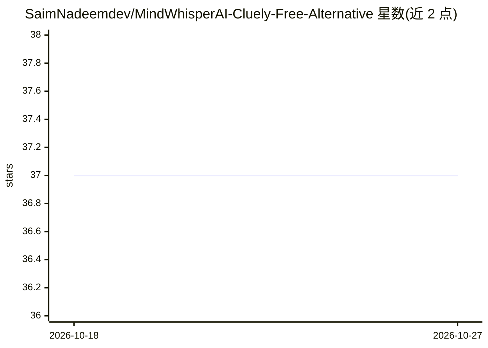

# SaimNadeemdev/MindWhisperAI-Cluely-Free-Alternative

⭐ 37 · 推送 2026-01-27 · [GitHub](https://github.com/SaimNadeemdev/MindWhisperAI-Cluely-Free-Alternative) · [官网](https://mindwhisperai.vercel.app/) · 个人维护

**隐形 AI 面试/会议助手：实时转录、即时作答与隐身悬浮窗**

跨平台（Windows/macOS/Linux）桌面应用，以透明置顶悬浮窗形式在面试、销售电话、演示等场景中提供实时转录、即时 AI 回答、截图 OCR 分析与编码/行为面试辅助，含全局快捷键与隐身模式（宣称对 Zoom/Teams 等录屏不可见）。云端默认用 Gemini API key，也可配置 Ollama（llama3.2 等）完全本地运行。安装需 Node.js 18+，从源码克隆构建；采用 MIT 许可，同时列有 $10/月 的付费档位描述。

## 筛选速览

| 维度 | 判定 | 备注 |
|---|---|---|
| AI 角色 | `ai-native` | 本体是模型或模型工具 |
| 许可风险 | `none` | — |
| 部署形态 | `None` |  |
| 模型依赖 | local-ok | 支持本地模型 |
| 硬件要求 | — | 无带数字的原话,不猜 |
| 安装摩擦 | `low` | 无编译、无系统依赖或容器化 |
| 成熟度 | — | 结构信号不足 |

## 能力要点

- 实时转录（宣称 95%+ 准确率、<300ms 延迟）与即时回答生成
- 隐身模式与全局快捷键控制的透明置顶悬浮窗
- 支持 Ollama（llama3.2/CodeLlama/Mistral）本地离线运行
- 截图 OCR 与视觉分析，覆盖编码、销售、演示等多场景

## 适用场景

- 技术/行为面试中获得实时提示与答题辅助
- 销售电话中进行实时异议应对与话术支持
- 演示或会议中做实时资料查询与截图分析
- 离线用本地模型保障隐私地使用 AI 助手

## 场景标签

`AI 助手` `语音识别` `OCR` · 领域:对话与助手

## 证据(README 行号)

> L22: **MindWhisper AI** is the next-generation, **invisible AI assistant** that provides **real-time answers, insights, 
> L79: - **Live Transcription** — 95%+ accuracy with <300ms latency
> L97: - **Local AI Option** — Run 100% offline with Ollama (Llama 3.2, CodeLlama, Mistral)

## 星数曲线

2026-10-18 37 → 2026-10-27 37（+0）

---
*卡片 v1 · prompt 1.4 · 生成 2026-10-25 · 置信度 high · 依据 README sha `1a9ec5459081` · [字段定义](../../DATASET.md)*
