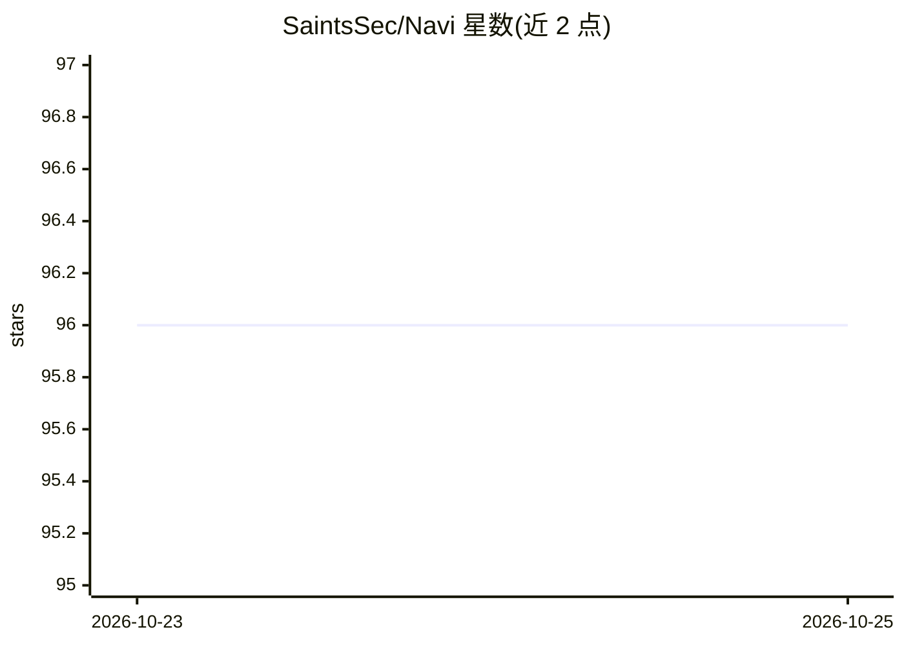

# SaintsSec/Navi

⭐ 96 · Python · AGPL-3.0 · 推送 2026-10-06 · [GitHub](https://github.com/SaintsSec/Navi) · [官网](https://www.saintssec.org/) · 组织维护

**面向网络安全从业者的 AI 命令行聊天界面**

Python 编写的 CLI 工具，为网络安全从业者提供 AI 对话界面。内置本地 AI 系统 Navi3b，后台通过 ollama 运行 WhiteRabbitNeo 模型，首次启动时以 navi --edge 安装。提供 chips 扩展系统（含 chip 创建器与模板）、仅本地的会话记忆，以及从 PDF 读取数据供模型做知识增强的 RAG 功能。旧版本需清理 /opt/Navi 后重装以使自动更新正常工作。项目处于持续开发中，路线图含训练等未完成项。

## 筛选速览

| 维度 | 判定 | 备注 |
|---|---|---|
| AI 角色 | `ai-native` | 本体是模型或模型工具 |
| 许可风险 | `viral` | AGPL-3.0 |
| 部署形态 | `None` |  |
| 模型依赖 | local-ok | 支持本地模型 |
| 硬件要求 | — | 无带数字的原话,不猜 |
| 安装摩擦 | `low` | 无编译、无系统依赖或容器化 |
| 成熟度 | — | 结构信号不足 |

## 能力要点

- 本地 AI 系统 Navi3b，经 ollama 运行 WhiteRabbitNeo
- chips 扩展系统与 chip 创建器、模板
- 仅本地的会话记忆（Local Only）
- 从 PDF 读取数据的 RAG 知识增强

## 适用场景

- 在终端与本地 AI 模型对话处理安全相关任务
- 通过 chips 扩展 Navi 功能并自建 chip
- 把 PDF 资料接入对话作为知识来源

## 场景标签

`聊天机器人` `RAG` `网络安全` · 领域:对话与助手

## 证据(README 行号)

> L12: - **Navi3b** - The first iteration of our local AI system. Currently running WhiteRabbitNeo with ollama in the back
> L18: - **Navi RAG** - We implimented a RAG System into Navi that will be take data from PDF's and allow the model to use

## 星数曲线

2026-10-23 96 → 2026-10-25 96（+0）

---
*卡片 v1 · prompt 1.4 · 生成 2026-10-23 · 置信度 mid · 依据 README sha `9005538ba3f5` · [字段定义](../../DATASET.md)*
