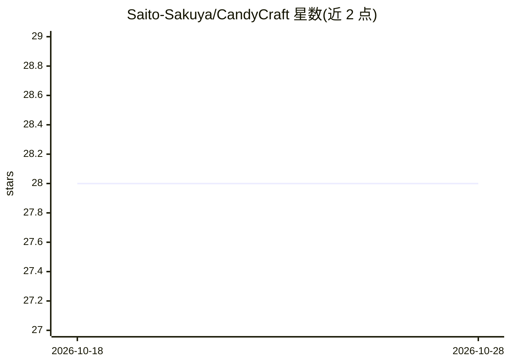

# Saito-Sakuya/CandyCraft

⭐ 28 · JavaScript · MIT · 推送 2026-05-27 · [GitHub](https://github.com/Saito-Sakuya/CandyCraft) · [官网](https://candy.aninoi.com) · 个人维护 · 中文 README

**可视化 AI 生图提示词工作台，面向生图用户优化提示词**

纯静态前端 + Cloudflare Pages Functions 的提示词优化工具：用户输入提示词后由 AI 生成 8 项调节维度、画板元素、预设方案与相机布光建议，支持画板拖拽编辑、构图比例/像素设置、Three.js 3D 场景只读预览、文本透传与排除约束，最终按版本化 JSON 合同输出优化后的生图 prompt。AI 调用支持后台托管（密钥存服务端）与用户自定义（OpenAI 兼容端点，structure/lighting/normalize 三角色分别配置）两种模式。无构建步骤，可用 Wrangler 本地运行或部署到 Cloudflare Pages。当前版本 BetaA.a.8。

## 筛选速览

| 维度 | 判定 | 备注 |
|---|---|---|
| AI 角色 | `ai-native` | 本体是模型或模型工具 |
| 许可风险 | `permissive` | MIT |
| 部署形态 | `library` | 以包/库形式分发 |
| 模型依赖 | — | README 未给出锁定关系 |
| 硬件要求 | — | 无带数字的原话,不猜 |
| 安装摩擦 | `low` | 无编译、无系统依赖或容器化 |
| 成熟度 | — | 结构信号不足 |

## 能力要点

- 画板/构图/相机布光/三视图与 Three.js 3D 预览的提示词工作台
- 双模式 API：后台托管（密钥存 Pages Secrets）与用户自定义三角色端点
- AI 输出采用版本化 JSON 合同（cc.analysis.v1 等）含失败回退与降级
- 对象级与全局排除/反向提示词，Exact Text Blocks 原文透传

## 适用场景

- 在可视化画板上编排并优化 AI 生图提示词
- 海报模式从空画板开始创作并保留确定文本
- 公开部署给多人使用且不在浏览器暴露上游密钥
- 自备 OpenAI 兼容端点（含多供应商）本地使用

## 场景标签

`提示工程` · 领域:Agent 开发

## 证据(README 行号)

> L3: > AI 驱动的可视化生图提示词优化工具。
> L12: Candy Craft 是一个纯静态前端 + Cloudflare Pages Functions 的可视化生图提示词工作台。它把提示词分析、画板编辑、构图尺寸、相机布光、风格维度、文本保真、排除约束和最终提示词优化整合到一个可操
> L25: - 分析提示词后生成固定 8 项调节维度、画板元素、预设方案、场景建议与构图建议。

## 星数曲线

2026-10-18 28 → 2026-10-28 28（+0）

---
*卡片 v1 · prompt 1.4 · 生成 2026-10-26 · 置信度 high · 依据 README sha `d88249526b90` · [字段定义](../../DATASET.md)*
