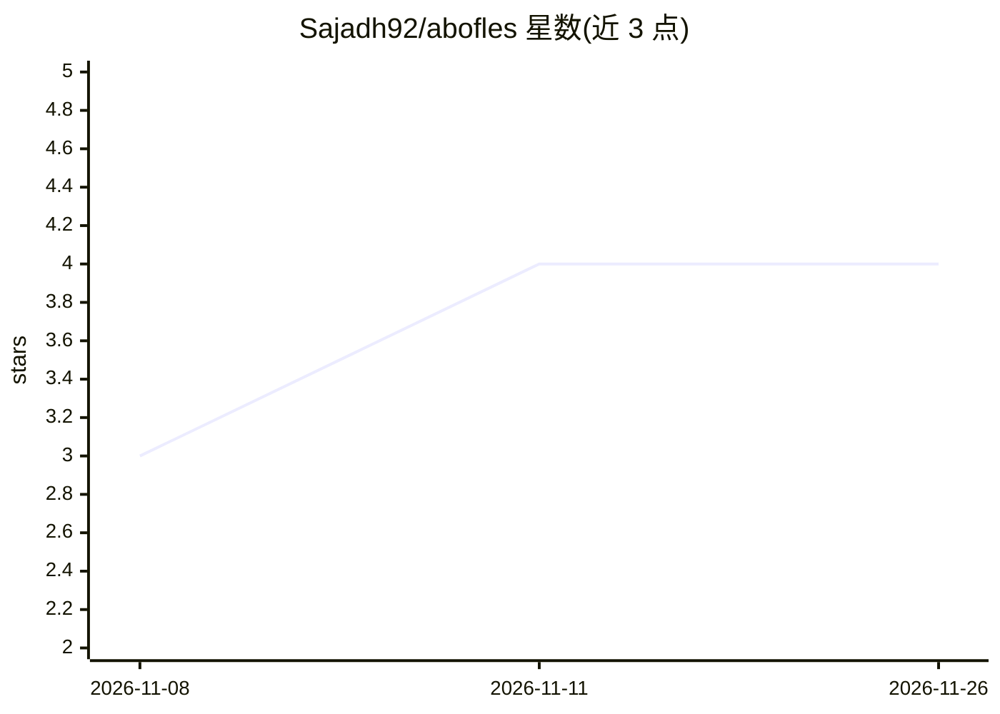

# Sajadh92/abofles

⭐ — · [GitHub]() · 个人维护

**Claude Code 插件：按任务将子代理路由到对应模型与投入档位**

一个 Claude Code 插件市场的仓库，核心插件 abofles 统计每个 token，将每个 subagent 路由到合适的模型与 effort 档位（Haiku 读取、Sonnet 构建、Opus 决策），用于控制 token 消耗。附带 abofles-guide 插件，提供侧边面板（运行状态、指南、恢复、代理列表、覆盖编辑器）与提示框上方的导航条，通过 /abofles-pane 开关。通过 Claude Code 的 /plugin marketplace 命令安装，默认关闭第三方市场的自动更新，另需在 ~/.claude/CLAUDE.md 中添加技能调用规则。MIT 许可。

## 筛选速览

| 维度 | 判定 | 备注 |
|---|---|---|
| AI 角色 | `ai-ecosystem` | LLM/agent 周边工具 |
| 许可风险 | `permissive` | — |
| 部署形态 | `None` |  |
| 模型依赖 | — | README 未给出锁定关系 |
| 硬件要求 | — | 无带数字的原话,不猜 |
| 安装摩擦 | `low` | 无编译、无系统依赖或容器化 |
| 成熟度 | — | 结构信号不足 |

## 能力要点

- 按任务将 subagent 路由到 Haiku/Sonnet/Opus 与对应 effort 档位
- token 计数与每会话一次的任务分级技能（abofles skill）
- abofles-guide 提供运行面板、覆盖编辑器与撤销/备忘导航条

## 适用场景

- 在 Claude Code 中降低多代理工作流的 token 成本
- 按任务复杂度自动分派不同档位的模型
- 通过面板查看正在运行的代理并手动覆盖路由设置

## 场景标签

`编码 Agent` `模型网关` · 领域:Agent 开发

## 证据(README 行号)

> L3: A Claude Code plugin marketplace.
> L7: |abofles|Abo Fles (ابو فليس) counts every token: routes each subagent to the right model and effort.|

## 星数曲线

2026-11-08 3 → 2026-11-26 4（+1）

---
*卡片 v1 · prompt 1.4 · 生成 2026-11-21 · 置信度 high · 依据 README sha `7da083c5b6a5` · [字段定义](../../DATASET.md)*
