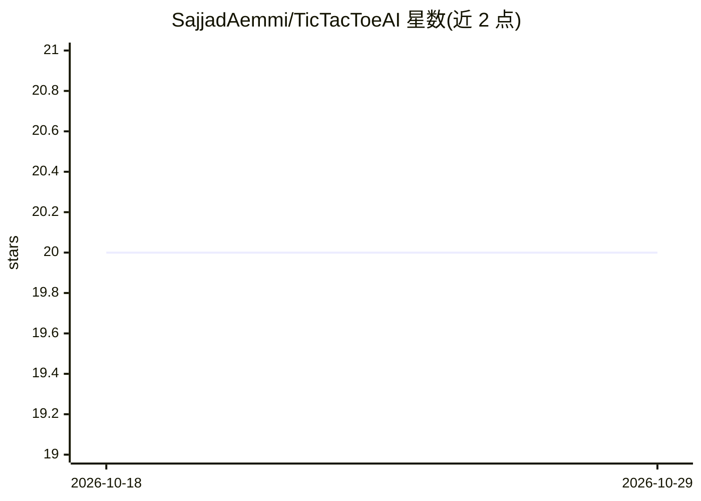

# SajjadAemmi/TicTacToeAI

⭐ 20 · JavaScript · 推送 2025-12-22 · [GitHub](https://github.com/SajjadAemmi/TicTacToeAI) · 个人维护

**带 AI 对手的井字棋游戏，提供多语言多版本实现**

一个 3x3 井字棋项目，AI 作为游戏对手参与对局。仓库提供四种实现：JavaScript 网页版（可在线试玩）、Python 命令行版、C++ 与 Java 的 GUI 版本。按 TODO 列表，目前 AI 功能仅已加入 Python 版本，C++ 和 Java 版本的 AI 尚未实现，Python 版本的 GUI 也待补。README 未提供安装命令与依赖说明。

## 筛选速览

| 维度 | 判定 | 备注 |
|---|---|---|
| AI 角色 | `ai-native` | 本体是模型或模型工具 |
| 许可风险 | `none` | — |
| 部署形态 | `None` |  |
| 模型依赖 | — | README 未给出锁定关系 |
| 硬件要求 | — | 无带数字的原话,不猜 |
| 安装摩擦 | `low` | 无编译、无系统依赖或容器化 |
| 成熟度 | — | 结构信号不足 |

## 能力要点

- 提供 JavaScript/Python/C++/Java 四种语言实现
- 网页版支持在线试玩
- AI 功能当前已加入 Python 版本

## 适用场景

- 在线或本地与 AI 对战井字棋
- 对比多种语言实现同一游戏项目

## 场景标签

 · 领域:游戏/娱乐

## 证据(README 行号)

> L3: TicTocToe 3x3 game with Artificial Intelligence
> L12: - [x] Add AI to Python version

## 星数曲线

2026-10-18 20 → 2026-10-29 20（+0）

---
*卡片 v1 · prompt 1.4 · 生成 2026-10-28 · 置信度 mid · 依据 README sha `8696bacb353c` · [字段定义](../../DATASET.md)*
