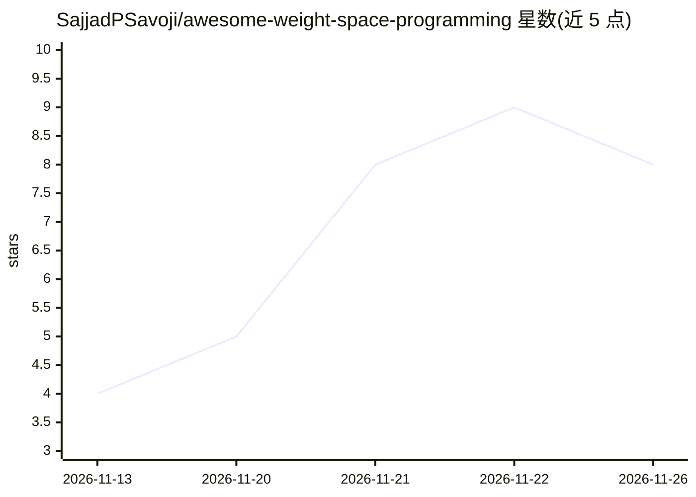

# SajjadPSavoji/awesome-weight-space-programming

⭐ 8 · Python · CC0-1.0 · 推送 2026-11-25 · [GitHub](https://github.com/SajjadPSavoji/awesome-weight-space-programming) · [官网](https://rikiyat.github.io/blog/weight-space-programming/) · 个人维护

**权重空间编程论文与代码的每日更新策展清单**

收录「读取、编辑、写入其他神经网络权重」这一主题的论文、代码、基准与批评文献，按被编程的网络类型分组，另设 Foundations 章节追溯 1943 年以来的早期工作。清单从 data/entries.json 重建，标注每日更新，采用 CC0-1.0 许可。面向追踪该方向研究的读者；不提供可运行的软件本体，条目指向各论文的仓库与预印本链接。

## 筛选速览

| 维度 | 判定 | 备注 |
|---|---|---|
| AI 角色 | `ai-knowledge` | 知识聚合/清单类 |
| 许可风险 | `viral` | CC0-1.0 |
| 部署形态 | `None` |  |
| 模型依赖 | — | README 未给出锁定关系 |
| 硬件要求 | — | 无带数字的原话,不猜 |
| 安装摩擦 | `low` | 无编译、无系统依赖或容器化 |
| 成熟度 | — | 结构信号不足 |

## 能力要点

- 收录权重空间编程方向的论文、代码、基准与批评文献，按网络类型分组
- 设 Foundations 章节收录 McCulloch-Pitts（1943）以来的早期权重读写工作
- 从 data/entries.json 自动重建，标注每日更新
- 含 Milestones 时间线与 Recently Added 条目

## 适用场景

- 查找权重编辑/激活导向方向的论文与开源实现
- 跟踪该新兴研究方向的最新条目与里程碑
- 为模型编辑相关研究寻找复现与基准资源

## 场景标签

`精选清单` · 领域:学习与行业

## 证据(README 行号)

> L3: **Language models that read, edit and write the weights of other neural networks directly, without gradient descent.
> L11: *Weight-space programming* was named in the MIT CSAIL report Sparks of Weight-Space Programming (2026-11-02). A gen

## 星数曲线

2026-11-13 4 → 2026-11-26 8（+4）

---
*卡片 v1 · prompt 1.4 · 生成 2026-11-21 · 置信度 high · 依据 README sha `06f80e8fc3a2` · [字段定义](../../DATASET.md)*
