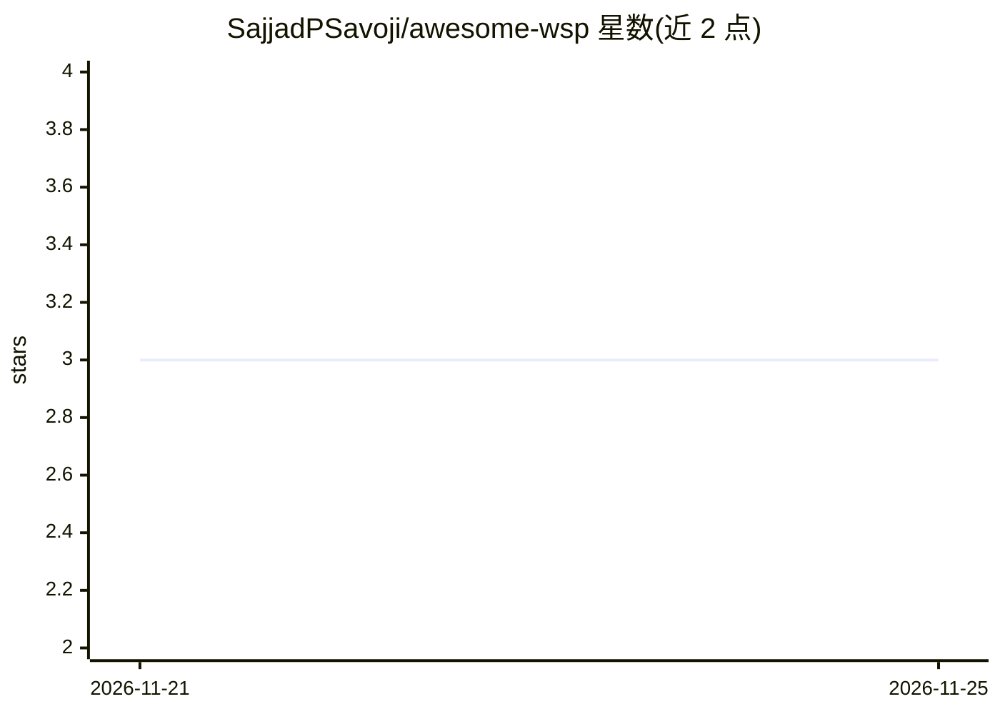

# SajjadPSavoji/awesome-wsp

⭐ — · [GitHub]() · 个人维护

**面向研究者收录权重空间编程论文与代码的清单**

一份每日更新的精选清单，收录权重空间编程（weight-space programming）领域的论文、代码、基准与批评文章。条目来自 data/entries.json 重建，按被编程网络的类型分组，设 Foundations、Language Models 等板块，记录 MIT CSAIL 报告提出该术语之后的相关工作，含里程碑时间线与最近添加列表。以镜像仓库形式发布，许可为 CC0-1.0，贡献指回主仓库。

## 筛选速览

| 维度 | 判定 | 备注 |
|---|---|---|
| AI 角色 | `ai-knowledge` | 知识聚合/清单类 |
| 许可风险 | `viral` | — |
| 部署形态 | `None` |  |
| 模型依赖 | — | README 未给出锁定关系 |
| 硬件要求 | — | 无带数字的原话,不猜 |
| 安装摩擦 | `low` | 无编译、无系统依赖或容器化 |
| 成熟度 | — | 结构信号不足 |

## 能力要点

- 按被编程网络类型分组的论文/代码/基准条目
- 每日更新，含最近添加与里程碑时间线
- 收录带代码与预印本链接的实验与批评性条目
- 从 data/entries.json 结构化数据重建

## 适用场景

- 查找权重编辑与激活引导方向的新论文和代码
- 了解 MIT CSAIL 报告提出该术语后的研究进展
- 为模型编辑类研究寻找基准与对照实验

## 场景标签

`精选清单` `科研工具` · 领域:学习与行业

## 证据(README 行号)

> L1: # Awesome Weight-Space Programming Awesome
> L3: **Language models that read, edit and write the weights of other neural networks directly, without gradient descent.
> L13: *Weight-space programming* was named in the MIT CSAIL report Sparks of Weight-Space Programming (2026-11-02). A gen

## 星数曲线

2026-11-21 3 → 2026-11-25 3（+0）

---
*卡片 v1 · prompt 1.4 · 生成 2026-11-22 · 置信度 high · 依据 README sha `ffbea4e1489f` · [字段定义](../../DATASET.md)*
